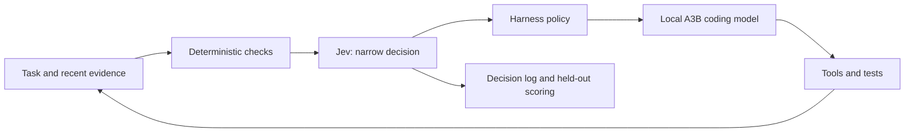

# Jev research and integration choices

Research date: September 24, 2026. Recommendation: evaluate a small existing Pi adapter on recorded decisions before enabling automatic routing or context pruning.

Follow-up: [exact harness versions and settings](JEV-HARNESS-COMPATIBILITY-2026-09-24.md) identifies required Claude function-hook versions, OpenCode V2 requirements, the removed Codex plugin_hooks flag, isolated Pi config pitfalls, and MoonTory's existing loop-observation extension. That report refines the first experiment recommendation.

The review covered official documentation, 13 GitHub projects, and transcript material from nine videos. Eight repositories were pinned and downloaded; 15 implementation/package/report files were inspected locally. Video coverage means selected transcript passages, not watching every video or verifying every demonstration. Two video sources expose only partial captions. No extension was installed, no Jev API request was made, and no local inference was launched.

## What Jev adds to our lab

Jev accepts state and narrowly specified questions, returning typed decisions and probability distributions. Its Noul, Choice, and Score interfaces fit classification and routing around a coding model. Code generation remains with our local model. This is the integration model described in the [official coding-agent guide](https://docs.typesafe.ai/introduction/coding-agents).

Our first experiment should stop at the decision log: record what Jev would recommend while the existing harness continues unchanged. That lets us measure mistakes before they affect a coding run.

This complements the completed A3B placement screen. Hosted Jev does not need another set of local model weights, but introduces network latency and sends the supplied state to TypeSafe. It does not implement expert caching or reduce A3B weight residency. The local Qwen3-Coder placement candidate still needs coding-quality validation; its roughly 33 tok/s continuation result is not such a validation. See our [A3B report](../ai_bench/a3b-offload-20260924-v1/REPORT.md).

The supplied [Wikipedia article](https://en.wikipedia.org/wiki/Jev_(AI_model)) was useful for discovery. Implementation claims below use vendor documentation and repository evidence. I found no official downloadable Jev weights in the reviewed material. LocalJev and Laya are different ways to implement similar interfaces, not releases of Jev's weights.

## Which harness to use

| Harness | Available integration | Recommendation for our setup |
|---|---|---|
| Pi 0.86.1 lab | Native typed-decision extensions, routers, context hooks | First choice: smallest adapter, pinned version, replay before control |
| LangChain/LangGraph | Official provider integration and middleware | Best documented route for a standalone orchestration experiment |
| Claude Code | Community tools, prompt hooks, compaction experiments | Typed tools first; verify hook version requirements separately |
| OpenCode | Community compaction port targets V2 context hook | Not a verified drop-in for our recorded 1.17.15 installation |
| Codex | Community evidence-recovery plugin and studies | Interesting research; benefit over native/local recovery remains unestablished |
| Aider / dsh / Open Interpreter | No verified native Jev adapter found in this review | A separate replay evaluator is less invasive than changing the harness |

LangChain documents `TypeSafeClassifier` as a Runnable and exposes experimental `ModelRouterMiddleware` and `AutoModeMiddleware`. Current invocation passes both state and questions. These are concrete integration points, but the existence of middleware is not evidence that its decisions improve our tasks. [Provider documentation](https://docs.langchain.com/oss/python/integrations/providers/typesafe), [harness walkthrough](https://www.langchain.com/blog/building-a-harness-with-jev).

## GitHub findings

The first eight entries have local snapshots with commit identities and SHA-256 hashes. Remaining entries were reviewed through public repository pages and linked reports. Static findings below were not confirmed by executing the downloaded code.

| Project | What it provides | Finding and disposition |
|---|---|---|
| [angribot/pi-jev](https://github.com/angribot/pi-jev) | Single-file `jev_evaluate` Pi tool | Best small starting point. Handles typed questions and retains raw responses. Hardcodes `jev-latest`; pin the model for experiments. Its optional file input needs a deliberately bounded fixture policy. |
| [FrancoisChastel/jev-code](https://github.com/FrancoisChastel/jev-code) | MCP server and native Pi tools for classify/check/score/rank/ask | More complete reusable toolbox. Pi score description advertises 2-20 levels, while the current API allows 2-10. Reconcile schema/client behavior before use; this review did not reproduce a live failure. |
| [iefnaf/pi-jev](https://github.com/iefnaf/pi-jev) | Pi routing and compaction suite | Router sends the latest prompt without conversation history. Its model-reference parser treats any final colon suffix as thinking level. `lab/qwen3-coder:30b` therefore becomes model `qwen3-coder`, thinking `30b`. Fix parsing or use compatible aliases before our routing trial. |
| [QuentinDanblon/pi-fast-jev-compaction](https://github.com/QuentinDanblon/pi-fast-jev-compaction) | Prunes outgoing Pi context while preserving stored history | Worth a later trial. Background work and concurrency defaults need changing for our serial policy. Reported savings concern screenshot-heavy examples and modeled costs, not demonstrated coding-quality gains. |
| [tamaratran/fast-jev-compaction](https://github.com/tamaratran/fast-jev-compaction) | Original scoring/compaction implementation and Claude hooks | Version-sensitive hook requirements. Scorer state replaces tool-result bodies with metadata, limiting what it can judge. Demo animation is scripted; tests with fake Jev are not live-model evidence. |
| [JoacoMarc/jev-harness-router](https://github.com/JoacoMarc/jev-harness-router) | Router policy, replay evaluation, deadlines, Claude Agent SDK adapter | Useful evaluation pattern. Author's results show prior-turn context materially affects routing; headline speed alone is insufficient. Thresholds should be fitted to our tasks. |
| [AbdelStark/jev-benchmarks](https://github.com/AbdelStark/jev-benchmarks) | Classification, calibration and abstention evaluation | Useful template for our replay study. Accuracy and probability quality must be scored separately. |
| [githubnext/localjev](https://github.com/githubnext/localjev) | Jev-compatible API backed by an OpenAI-compatible local model | Useful local control, not actual Jev. Probabilities are generated by the backing model rather than read from its class logits. Published hardware/results do not establish performance on our RTX 5070. |
| [jcressler/fast-jev-compaction-codex](https://github.com/jcressler/fast-jev-compaction-codex) | Exact local evidence archives with optional Jev ranking | Particularly useful because it publishes unfavorable results and corrections. Latest audit establishes working integration, not a quality or efficiency advantage. |
| [nrdz-labs/fast-jev-opencode](https://github.com/nrdz-labs/fast-jev-opencode) | Context-pruning port | Explicitly targets OpenCode V2's context hook; compatibility with our older installation is unverified. |
| [kaiyes/fast-jev-compaction-laya](https://github.com/kaiyes/fast-jev-compaction-laya) | Local Laya scoring variant | Apple MLX implementation; not a direct Windows/CUDA installation choice. |
| [dhruvmehra/jevbench](https://github.com/dhruvmehra/jevbench) | Jev versus LLM, BERT, Laya and NLI evaluation | Useful comparison framework. Fine-tuned and zero-shot models have different training advantages; avoid treating the table as a universal ranking. |
| [TypeSafeAI/jev-harness](https://github.com/TypeSafeAI/jev-harness) | Proposal, decision, policy and receipt architecture | Despite the organization name, identifies itself as independent community work. Its scripted/mock success result does not establish live Jev reliability. |

Pinned implementation evidence: [Pi tool](https://github.com/angribot/pi-jev/blob/013e1e8f1e7230b8445a8e12ac514c369993f152/pi-jev.ts), [score description](https://github.com/FrancoisChastel/jev-code/blob/051b492a201d5fe97dd26c422dcc5d7ed24b033c/integrations/pi/jev.ts), [model-reference parser and prompt-only routing](https://github.com/iefnaf/pi-jev/blob/cd168457a8b340352d1ae1e9e4785305954b5751/src/routing/extension.ts), [compaction state construction](https://github.com/tamaratran/fast-jev-compaction/blob/e3f262a7f4d42bd8dd32ced30d26176f7cb545b0/src/state.ts).

## Evidence that changes the recommendation

**Typed output does not imply a correct decision.** Official documentation lists failures involving arithmetic, dates, counting, indirect instructions, irrelevant context, contradictions and adversarial text. Use ordinary code for exact invariants and calculations. Jev can advise a policy; it should not replace our memory gates, command approvals or test oracle. [Known limitations](https://docs.typesafe.ai/model-jaggedness/jev-1.13).

**Confidence needs task-specific validation.** Choice/Score confidence is a property of the returned distribution, not a measured guarantee that a particular answer is correct. Noul returns a probability directly. We should measure calibration and coverage on our cases instead of adopting a universal 0.9 threshold. [Confidence documentation](https://docs.typesafe.ai/confidence).

**Independent classification results are mixed in useful ways.** AbdelStark's 300-example pilot reports Jev accuracy of .910 on AG News and .870 on Banking77, versus .700 and .610 for its GLiNER comparator. On Emotion, .480 versus .440 comes with uncertainty spanning no advantage; Jev's Brier score and log loss were worse. Those are small, specific datasets and remote-versus-local latency conditions, not a coding-agent benchmark. [Pinned pilot report](https://github.com/AbdelStark/jev-benchmarks/blob/0d610cc53e79bcbec691312b0c4adb4a0e371642/results/reports/btzsc-pilot-v1.md).

**Context pruning has not earned a default change.** The Pi compactor reports modeled net prompt-cost reductions of 31.8% and 37.7% on two screenshot-heavy sessions. Its own image estimates differ from Pi usage counters. We need text-heavy coding tests and actual local prefill/KV-cache measurements before expecting similar gains. [Pinned README](https://github.com/QuentinDanblon/pi-fast-jev-compaction/blob/679041b8511515c9a0fcebd617afebabd87ae7f6/README.md).

**The newest Codex audit is inconclusive, not a verdict against Jev.** All three arms passed 12/12 tasks; all 24 Jev selections succeeded. However, important information remained recoverable from workspace files, leaving no quality headroom for retrieval to help. Paired latency, token and proxy-cost uncertainty spans both directions. Earlier reranking failures remain informative but concern different implementations. The authors explicitly conclude that the latest trial proves integration and non-regression, not superiority or inferiority. [September 19 audit](https://github.com/jcressler/fast-jev-compaction-codex/blob/main/benchmarks/AUTOMATIC-EXPLICIT-RESULTS-AUDIT-2026-09-19.md).

## Nine video/transcript sources

These are reading notes, not independently reproduced demonstrations. Transcript mirrors can contain transcription mistakes. Technical recommendations are cross-checked against primary documentation and code above; promotional speed, price and reliability claims are not treated as measurements of our setup.

| Video | Material reviewed | Useful takeaway |
|---|---|---|
| [Latent Space: Diogo Almeida on Jev](https://www.latent.space/p/jev) | Publisher transcript; selected passages around 54:04, 58:28 and 1:38:48 | Best conceptual discussion of typed questions, decomposing decisions, and agents built around multiple model roles. Design intent rather than comparative proof. |
| [LangChain x TypeSafe: Build a Harness](https://www.youtube.com/watch?v=HHUsHkYhkcM) | [Transcript mirror](https://www.usetranscribe.io/yt/HHUsHkYhkcM/build-harness-langchain); tool-decision demo and approximately 39-45 minutes | Most useful implementation discussion. Domain thresholds, ambiguous valid options, and long-state degradation all matter. |
| [Theo: Jev is incredible](https://www.youtube.com/watch?v=F3YXg7AaKWE) | [Transcript mirror](https://www.usetranscribe.io/yt/F3YXg7AaKWE/jev-data-processing-model); selected discussion around 21-26 minutes | Useful counterweight to compaction hype: preserving evidence and cache behavior can matter more than shrinking a prompt. Commentary, not our benchmark. |
| [David Ondrej: Build Anything With Jev](https://moderncreator.app/2026-09-19-david-ondrej-build-anything-with-jev-typesafe-ai-s-probability-only-model) | Transcript sections including opening reliability claims and application examples | Broad application ideas. Promotional claims about hallucinations do not override documented decision failures. |
| [LangChain: Building a Harness with Jev](https://www.youtube.com/watch?v=VE5dsWll06M) | [Four caption excerpts](https://learningatlas.us/learning/video/VE5dsWll06M), approximately 0:55, 3:55, 6:14, 7:45; not full transcript | Compact introduction to classification, routing and evaluation; first-party blog supplies implementation context. |
| [RepoChad: Schema-Safe AI](https://readpodcast.ai/en/youtube/repochad-cUCtyEhOTxGx45sljlfryc6jw/jev-the-schema-safe-ai-that-could-change-automation-forever-vRPpQacmBe4A) | Partial transcript through approximately 2:58, plus page summary | Explicit distinction between a valid output schema and a wrong business decision. Remaining video not transcript-reviewed. |
| [Matthew Berman: We need to talk about Jev](https://moderncreator.app/2026-09-18-matthew-berman-jev-is-a-decision-engine-not-a-thinker-and-it-just-lost-a-chess-match-to-prove-it) | Transcript passages and chapter material | Good overview of the excitement, but demo speed and reported chess outcomes do not establish reasoning or coding strength. |
| [Nate Herk: 12 use cases](https://moderncreator.app/2026-09-19-nate-herk-ai-automation-jev-tested-on-12-use-cases-dominant-at-classification-upside-down-on-live-bitcoin-trades) | Actual transcript around 9-14 minutes | Classification dashboards and meeting labels are useful examples. At 12:52 he recommends a labeled evaluation set; trading demo is explicitly an immature paper-trading proof of concept. |
| [Kevin Badi: Add Jev to Claude Code](https://moderncreator.app/2026-09-19-kevin-badi-ai-operating-systems-how-to-add-jev-ai-to-claude-code-step-by-step) | Transcript approximately 1:20-4:51 | Demonstrates a prompt-interception/tool-lookup design. The broad Cursor/Codex references do not verify identical hooks in each product; the visible walkthrough is Claude-oriented. |

Prioritize the creator interview for understanding, LangChain webinar for implementation, and Theo plus the repository audits for limitations. The other videos broaden use cases but add little controlled evidence.

## Concrete next experiment

1. Start with the small `angribot/pi-jev` adapter design. Make model version configurable, bound state, remove arbitrary file ingestion from the replay path, and use one request at a time. Its native tool alone does not automatically observe every step; automatic observation requires a small event adapter later.
2. Create labeled replay cases from synthetic versions of our failure patterns: repeated reads, repeated failed writes, missing dependency, malformed tool output, actual progress, and insufficient evidence. Compare Jev with deterministic repeat/failure checks and a same-model local classification control.
3. Keep a development split and an untouched held-out split. Include short follow-ups such as 'proceed', with and without preceding context. Store labels and evaluator files outside candidate workspaces.
4. Ask narrow questions: 'Did this step change any file?', 'Is the same failed action being repeated?', 'Which recovery category applies?' Compute hashes, exit-code comparisons, elapsed time and memory checks in code.
5. Measure precision/recall by decision, false intervention rate, calibration, abstention coverage, request latency, bytes/tokens sent and actual charge. Pin a versioned Jev ID rather than `jev-latest`; `jev-1.13.0` is documented as accepted. Freeze thresholds before held-out evaluation. [Model IDs](https://docs.typesafe.ai/models).
6. Only after replay earns a benefit, compare paired coding runs: baseline, deterministic guard, and Jev-assisted guard. Keep model, prompt, context, task, time limit and memory gates identical. Evaluate completion, correctness, unwanted changes, total latency and cost. Stop/unload between local configurations.
7. Test pruning separately, later. Preserve exact archives, protect instructions and tool-call/result pairing, and include required facts that exist only in older evidence. Measure prefix-cache effects and recovery failures. Do not mix routing and pruning into the first treatment.

The current API accepts up to 255 Choice options and 2-10 Score levels. Question identifiers are not model-visible, so semantic instructions belong in the question fields. These details should be enforced in the adapter. [API reference](https://docs.typesafe.ai/api).

This is a proposed experiment, not a completed benchmark. No API key was accessed or transmitted for this research. Startup restoration remains complete, and the original no-reboot, single-inference and memory-gate constraints remain in force.

## Local evidence

- [Source manifest](../ai_bench/jev-research-20260924/sources/manifest.json): eight pinned repositories and six downloaded video/transcript pages.
- [Implementation manifest](../ai_bench/jev-research-20260924/sources/code-manifest.json): 15 downloaded files with hashes.
- [Public fetch helper](../ai_bench/jev-research-20260924/fetch_public_sources.py): read-only public-source retrieval, no model calls.
- The Berman, Herk and Badi transcript pages and five additional repositories were read through browsing rather than added to those local manifests.

Source snapshots are research inputs, not executed dependencies. No whole-repository security audit, package installation or live compatibility test is claimed.
