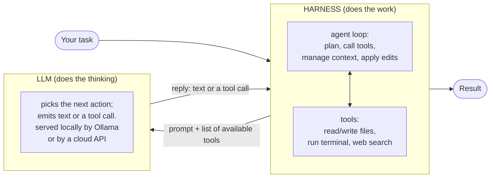

# local-llm-lab

**2026-10-10 &middot; [Two instruments, four profiles, and a rule that reverses four readings](../ai_bench/new-items-20261007/RECENT-WORK-2026-10-10.html)**
&ndash; the knowledge A/B (Qwen3.6 Q4_K_M 974/1100 = 88.5 % vs Qwen3.8-Flash-Next Q2_0 987/1100 = 89.7 %,
a 1.2-point gap against a 1.33-point standard error &mdash; indistinguishable, and the predicted low-bit
recall penalty did not appear), the Intel Arc iGPU measured at **0.39x** the RTX 5070 (with the first
attempt void because `CUDA_VISIBLE_DEVICES=''` means *unset*), the **starter-baseline rule** that
reversed four readings, and four nine-task profiles with `repo2` as the new discriminator.

**2026-10-09 &middot; [The new-task suite, measured end to end](../ai_bench/new-items-20261007/RECENT-WORK-2026-10-09.html)**
&ndash; the 414-check ranking (events/paths retired), Swift's context ladder (32,768 or nothing), the
Strata port and the two bugs it had to fix, and the variance work.

September 23: [completed follow-up results](FOLLOWUP-RESULTS-2026-09-23.md),
[trace review](COMPLETION-REVIEW-2026-09-23.md) and
[fixed completion experiment](COMPLETION-PLAN-2026-09-23.md).
Check the [current report](../ai_bench/completion-20260923-v1/REPORT.md) and
status.json before inference. The completion and overnight v3 queues are complete with cleanup
verified. [Memory-qualified CPU reruns](CPU-HEADROOM-PLAN-2026-09-23.md) are
prepared and held for headroom; original results remain separate.

September 22 continuation: [Go comparison evidence](CONTINUATION-RESULTS-2026-09-22.md),
[staged versus one-shot smoke](STAGING-RESULTS-2026-09-22.md), and
[Bonsai packing measurements](PACKING-RESULTS-2026-09-22.md).
The staging smoke hit its wall limit in both treatments, so the 30-run main
comparison remains held. Read each report's run status and limitations before
using its measurements.

Current experiments: [September 20 results](RESULTS-2026-09-20.md) track evaluator v2, the current Ollama replay, a pinned Pi comparison, and Bonsai 2 compatibility. Check the report's status before treating the round as complete.

Latest review: [September 20 research and audit](REVIEW-2026-09-20.md) covers this week's releases and corrects the historical cycle-failure explanation. Rechecking archived programs also exposed a self-test data overwrite in the Claude artifact; original scores are preserved.

Field notes from running AI LLM harnesses and local models on a deliberately limited desktop
(RTX 5070 12 GB / 32 GB RAM). What actually fits, what runs fast, which harness to use, and how we
tested it. Updated 2026-09-20.

This is a working lab notebook, not a product. Numbers are from one machine ("DARKTEXAS"); treat them
as directional. Research candidates are labeled separately from measured results.

Earlier baseline: [September 15 experiments](RESULTS-2026-09-15.md) add Pi, OmniCoder, a small Smoffyy variant, and a CPU-only baseline. The historical recommendations below precede that round.

Follow-up: [September 16 repeated trials](RESULTS-2026-09-16-OVERNIGHT.md) and [large tool-call streaming diagnosis](STREAMING-DIAGNOSIS-2026-09-16.md). The overnight hard-task failures exposed an output-limit configuration problem; see the diagnosis before interpreting their 0/10 scores.

## LLM vs harness (how they relate)

*The LLM is the brain; the harness is the body. The model only predicts text, it cannot touch your files
or run commands. The harness wraps it in a loop: it sends the model a prompt plus the list of tools it may
use, the model replies with either an answer or a tool call, and the harness executes that call (read a
file, run a command), feeds the result back, and repeats until the task is done. The model is swappable,
served locally by Ollama or by a cloud API, without changing the harness around it.*

### Why the same model gives different results in different harnesses

Point two harnesses at the identical Ollama endpoint and the same model, and you will still get different
behavior, sometimes wildly. The model is only one input; the harness controls everything around it:

- **System prompt and instructions** it wraps the request in. Each harness injects its own, often large,
  and that steering changes what the model does.
- **Which tools it exposes, and how it parses tool calls back** (native function-calling vs treating them
  as plain text). This is not cosmetic: opencode did nothing with qwen2.5-coder:7b because that model
  emitted its tool call as inline text, yet the same harness worked with qwen3-coder:30b, which emits
  native tool calls. Same endpoint, same task, opposite outcome.
- **Context it feeds in** - which files, how much history, the repo map, and how it compacts when the
  window fills. More or better context changes the answer.
- **The loop** - whether it plans first, works one step at a time, verifies and retries, or just fires a
  single shot. On hard tasks this is the biggest differentiator of all.
- **Model options it sets** - temperature, num_ctx, and whether "thinking" is on or off.

So "which model" is a smaller lever than most people expect. "Which harness, and how it is configured"
often decides whether a task actually completes.

### Breaking a large spec into small pieces (who is best)

For taking a big specification and working it incrementally instead of over-reaching:

- **Claude Code (best):** plans before it acts (plan mode), keeps a to-do list and does one item at a
  time, and can delegate scoped pieces to subagents. Purpose-built for decomposition.
- **DeepSeek Harness (dsh):** architecturally suited (goal / workflow / subagent / context-compaction
  plugins) but a dev preview, so less proven.
- **Aider (architect mode):** the practical local choice - it separates planning from editing and is
  naturally scoped to the files you add, so changes stay small. You drive the decomposition more than it
  does.
- **Open Interpreter:** weakest here - a step executor, not a long-horizon planner; it tends to just start
  doing rather than break the work down.

The discipline is really in the loop, not just the tool: a plan-first, small-diffs, iterate-and-verify
pattern (explore, write a plan, gate it, then implement and verify one small piece at a time) imposes
decomposition on whatever model you use.

The ranking above is from each harness's design (the features for staying scoped on hard, long tasks).
We also ran a measured head-to-head on a 7-part spec ([DECOMPOSITION-TEST.md](DECOMPOSITION-TEST.md)):
**all three completed it correctly**, so a medium spec does not separate them - Claude Code was fastest,
Aider's architect mode was the most transparent about its plan-implement-review loop, and a local
qwen3-coder:30b driving Aider handled the whole spec. Finding where each over-reaches needs a much larger
spec.

## TL;DR for a 12 GB / 32 GB box

- **Inference harness: Ollama.** Easiest, GPU-accelerated on Blackwell, OpenAI-compatible API, every agent
  tool plugs into it. LM Studio is a fine GUI alternative; llama.cpp for max control; vLLM only if you are
  serving many concurrent users (needs Docker + more VRAM).
- **What runs well locally:**
  - 7-14B dense at Q4/Q8 -> fully on GPU, fast (60-120 tok/s). The daily-driver class.
  - 30B **MoE with ~3B active** -> runs with CPU offload at a usable ~34-37 tok/s. Punches above its class.
  - 30B **dense** -> technically loads via offload but ~4-5 tok/s. Not practical here.
  - 100B+ / 1T models (Kimi, DeepSeek V4-Pro) -> do NOT run on this box. Cloud/API only.
- **The one rule that matters at 12 GB:** for anything above ~14B, only low-active-param MoE is usable.
  Active parameters, not total size, decide whether CPU offload wrecks your speed.
- **Agent harness:** Claude Code (cloud) for the hard work; **Aider** + **Open Interpreter** drive local
  models well; **DeepSeek Harness (dsh)** is promising but early; **opencode** works on local Ollama once
  you fix the config (127.0.0.1 + apiKey) and use a native-tool-calling model - see
  [OPENCODE-OLLAMA.md](OPENCODE-OLLAMA.md).
- **Local vs frontier:** on a well-specified medium task (a 7-part spec) local qwen3-coder:30b *matched*
  GPT-6 Astra, Claude, and DeepSeek V4-Pro - all correct. But on a harder spec (a dependency graph with
  topological `plan` and cycle detection) the local model dropped to **8/10** (it missed cycle detection
  and failed its own self-test) while every frontier option held **10/10**. That is the ceiling: locals
  are competitive up to real algorithmic complexity, past which the remote edge is real. See
  [BASELINE-REMOTE.md](BASELINE-REMOTE.md) and [HARD-SPEC-TEST.md](HARD-SPEC-TEST.md).

## Docs in this repo
- [RESULTS-2026-09-15.md](RESULTS-2026-09-15.md) - Pi, Aider, and OpenCode experiments, compact GGUF variants, and CPU-only measurements.
- [RESEARCH-2026-09-15.md](RESEARCH-2026-09-15.md) - new candidates, popular Hugging Face variants, CPU-only models, and Pi comparison plan.
- [HARDWARE.md](HARDWARE.md) - the exact box and its ceilings.
- [HARNESSES.md](HARNESSES.md) - inference harnesses and agent harnesses, with our findings.
- [OPENCODE-OLLAMA.md](OPENCODE-OLLAMA.md) - deep dive: why opencode "hangs" on local Ollama and the fix.
- [DECOMPOSITION-TEST.md](DECOMPOSITION-TEST.md) - head-to-head: three harnesses build the same 7-part spec.
- [BASELINE-REMOTE.md](BASELINE-REMOTE.md) - how the locals compare to cutting-edge remote (Codex + GPT-6 Astra).
- [HARD-SPEC-TEST.md](HARD-SPEC-TEST.md) - the harder spec where the local model finally slips (8/10 vs frontier 10/10).
- [examples/](examples/) - the actual programs each harness produced, plus the specs and the scorer.
- [transparent-decomposer.md](transparent-decomposer.md) - prompt that makes an agent show its plan and work step by step.
- [MODELS.md](MODELS.md) - local models tried, what fits, the MoE-vs-dense lesson.
- [METHODOLOGY.md](METHODOLOGY.md) - how we benchmark (probes, tok/s, placement).
- [RESULTS.md](RESULTS.md) - the measured numbers.
- [benchmarks/](benchmarks/) - the benchmark scripts.

## How to reproduce quickly
1. Install Ollama. `ollama pull qwen3:14b` (or any model in MODELS.md).
2. `ollama ps` shows GPU/CPU split; the API is at `http://127.0.0.1:11434`.
3. Run a probe with the script in `benchmarks/`.
