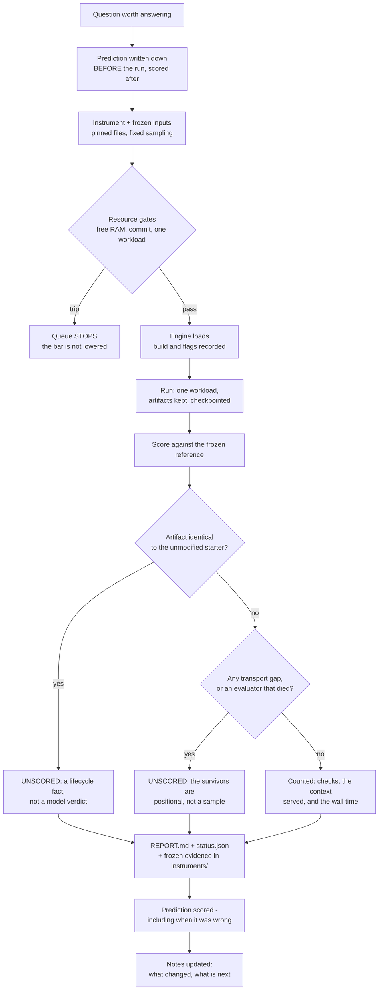

# local-llm-lab

Field notes from running large language models on one ordinary desktop - 64 GB DDR5, an RTX 5070 with
12 GB, two NVMe drives, Windows, no Docker - and measuring, rather than guessing, what fits, what is fast
and what each model actually scores. Every number here came from a run on this one machine, and every
claim carries the instrument that produced it.

Two habits are worth knowing before you read a number. A **prediction is recorded before each run and
scored afterwards, including when it is wrong** (that is what [section 4](#4-what-we-got-wrong) is), and a
run that cannot be scored is reported as **unscored, never as a zero**. Both habits exist because both
have been violated here, and every correction is kept in the open.

**Start here:** [1. What we would run today](#1-what-we-would-run-today) |
[2. How to read any number here](#2-how-to-read-any-number-here) |
[3. The numbers](#3-the-numbers) | [4. What we got wrong](#4-what-we-got-wrong) |
[5. Where the numbers come from](#5-where-the-numbers-come-from) |
[6. The mechanics](#6-the-mechanics)

This is a working lab notebook, not a product. Numbers are from one machine - "DARKTEXAS" is what this box
is called - so treat them as directional. Licence:
[FSL-1.1-MIT](#license) - source-available, **not** OSI open source.

## 1. What we would run today

Distilled from the nine-battery suite (693 checks: events, ledger, paths, ledger2, repo, longctx, repo2,
perf, longctx2) on this box. Each line is a measurement with its run behind it; the [dated reports](#reports)
carry the tables.

- **Best local configuration: Qwen3.6-35B-A3B Q4_K_M on llama.cpp, provisioned** - context 131,072,
  reply cap 32,768, thinking budget 6144, MoE experts on the CPU (`--cpu-moe --load-mode none`).
  **414/414** on the ranking metric, **565/565** on the six-task suite, **692/693** on all nine - the
  best result recorded here, at 1,300-2,700 s per full sweep.
- **A streamed low-bit giant ties it, and is cheaper in RAM.** Qwen3.8-Flash-Next Q2_0 served by Strata
  from disk with a 4 GiB resident budget also scores **414/414 and 692/693**, cell for cell, and answered
  a 1,100-item knowledge set **31 % faster in wall time** (2,128 s vs 3,078 s). On a 12 GB card that is a
  real option, not a toy.
- **What the two stacks know: the same.** 88.5 % vs 89.7 % over 1,100 MMLU + GSM8K items - a 1.2-point
  gap against a 1.33-point standard error - and the expected low-bit *recall* penalty did not appear.
  Run a knowledge benchmark before claiming a model is "smarter".
- **Rank by `ledger2`, `repo` and `repo2`, not by runs of small tasks.** `events` (76) and `paths` (75)
  are saturated (they split on 5/76 and 3/75 checks in the top group), so the metric is
  `ledger + ledger2 + repo + longctx` = **414 checks**. `repo2` (55) is where models still fail:
  34-48/55 for everything except the two leaders at 54/55, whose single miss is the same check.
- **Report each model at the context it can afford, and say which.** 131,072 for the six local models;
  **32,768 for Swift Bonsai 2**, which trips the 0.5 GiB GPU floor during load at 65,536 and above;
  65,536 for Strata. Nothing measured shows the raised context costing a battery.
- **The decision track: a 4B and a 9B inside one point, and the RAM upgrade changed nothing.** On
  Bespoke's published 3,880-record suite `nimble` 9B leads `kev4` 4B on the 13-subset macro (0.7565 vs
  0.7442) and on the class-balanced macro (0.7445 vs 0.7395), but **paired, both differences cross zero**
  (95 % CI [-0.0257, +0.0015] and [-0.0189, +0.0092]). Pooled record-level nimble is ahead (McNemar
  p = 0.0058), and by family it is nominally ahead in all three - noul +1.5 (p = 0.20), choice +1.6
  (p = 0.06), score +3.3 (p = 0.13) - yet no family comparison is significant. The binary family even
  splits by metric: nimble +1.1 on accuracy, **kev4 +0.8 on balanced accuracy**. Re-measured after the
  upgrade, all **7,760 records are identical** to the pre-upgrade run, so the suite is platform-invariant.
  Report balanced accuracy, the prediction rate and the majority baseline for skewed subsets, and
  `mean |prediction - target|` for the score family (nimble 0.727, kev4 0.787, lev 0.856, kev0 1.090,
  laya 1.224). Sources: `bespoke-metric-20261010/`, `bespoke-suite-20261010-v1/`.
- **The fastest models fail the hard axes; the fastest *successful* one is not the fastest.** On their
  first sweeps: gpt-oss-20b at 159 s/task but `repo` **0/78** (it broke the module import) and `longctx`
  15/40; MiniCPM5-2B at 176 s/task and 122 tok/s with `repo` 43/78. Both later reached 377 and 374 on the
  ranked metric - gpt-oss scoring `repo` 78/78 on a repeat - which is exactly the volatility the noise rule
  warns about, and a reason to read any single row of the table above as one sample. The fastest
  configuration that passes *everything* is Qwen3.6 + provisioning at 274 s/task.

## 2. How to read any number here

The process is the product. Every measurement in this repo went through the same loop, and the branches -
not the happy path - are what make the numbers comparable.

- **A prediction goes in before the run and is scored after it.** Every item in the overnight queues has
  its question and its prediction written into `REPORT.md` *before* the engine starts, and the morning
  scores them. Three of the entries in [section 4](#4-what-we-got-wrong) are predictions that failed.
- **One inference workload at a time, and the gates are checked rather than lowered.** 9 GiB free
  physical / 8 GiB commit / 0.5 GiB GPU free before an item, 3 / 2 / 0.5 GiB at runtime. A trip **stops**
  the queue and says so in `status.json`; it never lowers a bar to keep going. The drivers now also refuse
  to start while another measured run holds the inference slot.
- **Compare inside a run, never across runs.** A sweep's rows were produced under one engine build, one
  context, one set of flags; a number from a different session is a lead until it is re-measured here.
- **Know the noise floor before believing a difference.** On the discriminating battery, `ledger2` has
  spanned **19 checks** across six runs of one model (and 14 across five runs of another), and `repo` has
  swung **0-78** on the weakest two. Single-run `ledger2` differences below ~19 checks are noise.
- **Unscored is not zero.** Three distinct ways a run yields a number that is *not* a model verdict: the
  artifact equals the starter's (nothing was written), a transport gap leaves positional survivors, or the
  evaluator exited abnormally. All three are labelled in the record rather than counted as failures.
- **Other people's numbers are leads. Only this box's runs are evidence.** Vendor claims, community
  reports and papers are quoted with their source and treated as leads - the lab's news scans tag each one
  `status: lead` in those files. Several have been contradicted by a run here, and one of ours was
  contradicted by theirs: see [section 4](#4-what-we-got-wrong).

- **Before believing a low score, check it against the starter.** A score equal to the unmodified
  starter's baseline (events 2/76, ledger **7/70**, paths 9/75, ledger2 **62/226**, repo **0/78**,
  longctx 1/40, repo2 0/55, perf 1/33, longctx2 0/40) means the session **never wrote the file** - a
  lifecycle fact, not a model verdict. Four published readings were corrected by this rule. Hash the
  artifact against the starter to settle it; `clean_finish` cannot tell you.
- **`clean_finish`, `exit 143` and `quota_unknown` are not failures** - all three appear on 70/70 runs.
  Correctness is `evaluation.passed`, and a session killed at its wall *after* the artifact was complete
  still scores full marks.
- **Run repeats before concluding anything.** One model has produced 62-226 on `ledger2` (a no-op and a
  perfect run), another 144-203, and `repo` has swung 0-78 on one model. Single runs are samples.
- **Use the RTX 5070 and nothing else.** The Arc iGPU does work through Ollama's Vulkan backend but
  delivers **0.39x** the discrete card (100.8 vs 260.5 tok/s) while spilling to system RAM, and the NPU
  has no path in any engine here. The iGPU is at best a second device for small decision/embedding work.
- **Keep the floors.** 9 GiB free physical / 8 GiB commit headroom / 0.5 GiB GPU free before an item;
  3 / 2 / 0.5 GiB during it; one inference workload at a time. A trip is a measurement against the floor,
  not a reason to move it - the one deliberate loosening in this record (a 6 GiB worker-private cap) is
  named in [§6](#6-the-mechanics) with its date, and nothing else has been lowered.

## 3. The numbers

### The ranked batteries

The ranking metric is the discriminating subset - `ledger + ledger2 + repo + longctx` = **414 checks** -
because `events` (76) and `paths` (75) are saturated: they split on 5 and 3 checks respectively across the
whole top group. Each row carries the **context it was actually served**, which is a lab rule: nothing
measured shows the raised context costing a battery, and one model cannot take it at all.

| configuration | context served | ranked metric (414) | all nine batteries (693) |
|---|---|---|---|
| Qwen3.6-35B-A3B Q4_K_M, provisioned (`ext-v12`) | 131,072 | **414** | **692** |
| Qwen3.8-Flash-Next Q2_0, Strata, 4 GiB resident, streamed | 65,536 | **414** | **692** |
| Qwen3.6-35B-A3B (`ctx-v8`, the first provisioned sweep) | 131,072 | 411 | - |
| Qwen3.6 / Kolibri-1 78B (two runs, identical per task) | 131,072 | 400 | - |
| Nemotron (394 and 393 across two runs) | 131,072 | 393-394 | - |
| Swift Bonsai 2, the declared context exemption | 32,768 | 379 | - |
| gpt-oss-20b | 131,072 | 377 | - |
| MiniCPM5-2B | 131,072 | 374 | - |

The two perfect rows are the only ones at 414, and they tie **cell for cell** on all nine batteries: a
20 GB fully-resident MoE and a streamed 2-bit giant that keeps 4 GiB resident.

Three things this table is not. It is **one run per row** (two where a row says so); the battery most of it
rests on, `ledger2`, moves by up to 19 checks between runs of a single model (§2), so the 3-check gaps -
411 against 414, 394 against 393, 379 against 377 - are **orderings, not separations**, and only the top two
against the rest (34 checks and more) are outside the floor. The rows carry **no dates**, because every row
was produced under the pinned builds in §5 and re-running them is what the [reports](#reports) are for.
And the counts are the lab's own checks, not a task-success rate. For scale: the **six-task suite (565)** is
the 414 ranked checks plus `events` (76) and `paths` (75), and the **nine-battery total (693)** adds `repo2`
(55), `perf` (33) and `longctx2` (40).

### What they know

Two stacks, the same 1,100 items, two different engines and weight formats. The headline is in the figure;
the per-topic split, and the one topic whose gap clears noise, follow underneath.

### Note: knowledge breadth, the top two stacks (measured 2026-10-10)

1,100 pinned items each (800 MMLU over 8 subjects for recall + 300 GSM8K as the procedural control),
sampling pinned at temperature 0 / seed 20261009. This is the lab's first knowledge instrument; before
it, every battery here measured procedural coding/repair.

| stack | overall | MMLU (recall) | GSM8K (math) | wall | per item |
|---|---|---|---|---|---|
| Qwen3.6-35B-A3B Q4_K_M (llama.cpp, 131,072, cpu-moe) | 974/1100 = **88.5 %** | 688/800 = 86.0 % | 286/300 = 95.3 % | **51.3 min** | 2.80 s |
| Qwen3.8-Flash-Next Q2_0 (Strata, 65,536, 4 GiB resident, streamed) | 987/1100 = **89.7 %** | 699/800 = 87.4 % | 288/300 = 96.0 % | **35.5 min** | 1.93 s |

Per-subject, in case a topic matters to you:

| topic | Qwen3.6 | Strata Q2_0 | reading |
|---|---|---|---|
| astronomy | 95/100 | 96/100 | tie |
| high-school geography | 90/100 | 90/100 | tie |
| world history | 90/100 | 91/100 | tie |
| philosophy | 90/100 | 91/100 | tie |
| world religions | 86/100 | 89/100 | tie |
| international law | **93/100** | 90/100 | tie (Qwen3.6 nominally ahead) |
| **prehistory** | 86/100 | **94/100** | **Strata ahead - the only gap that clears noise** (~1.9 se) |
| **virology** | **58/100** | **58/100** | a ceiling in the items, not a model property |
| grade-school math | 286/300 | 288/300 | tie |

**The honest read: Strata is nominally ahead, not established ahead.** 13 items = 1.2 points overall
against a **1.33-point standard error**, with MMLU +1.4 and GSM8K +0.7 - all inside one se. What *does*
clear noise: the **wall time** (15.8 min, 31 % faster) and the **prehistory** topic. Meanwhile my
recorded prediction for this test was wrong in an interesting way - I expected ~2-bit weights to cost
*recall* first, and MMLU came out 87.4 % vs 86.0 %, i.e. no measurable penalty.

So **do not choose between these two on knowledge** - at this sample size they know the same things.
Choose on **cost and operation**: Strata served all 1,100 items in 35.5 min with only ~4 GiB resident and
66 GB on disk, while Qwen3.6 took 51.3 min and needs the whole ~20 GB MoE reachable through `--cpu-moe`,
i.e. system RAM - which is exactly why that recipe does not transfer to a 16 GB box.

### Note: the same tie, expanded (measured 2026-10-10)

A recognition tie does not mean they can *explain* the topic, so the pair were re-tested on the subject
they are most tied on. Design: the 8 shared-correct astronomy items that mention **Mars** (of 93
shared-correct astronomy items overall), a 25-fact list, and a ~550-word paper at three repeats; scored
against a pinned Wikipedia corpus (12 Mars-science pages, 63,297 words, sha256 `05e8091a…`); temperature
0, seed 20261009, fully local verification, no judge model.

| form | Qwen3.6-35B-A3B Q4 | Strata Qwen3.8-Flash-Next Q2_0 |
|---|---|---|
| reasoning on 93 shared-correct items | 90/93 (96.8 %) | **92/93 (98.9 %)** |
| 25-fact list, grounded | 25/25 | 25/25 |
| facts carrying figures | **16** | 8 |
| paper length (target ~550) | 408 words | 424 words |
| paper grounding | 0.86 | **0.98** |
| distinct paper topics over 3 repeats | 1 | 2 |

**Reasoning: no difference, now measured on 93 items rather than 8.** Asked for the answer plus the
decisive fact and the rejected distractor, Qwen3.6 scores 90/93 and Strata 92/93 - 1 discordant pair one
way, 3 the other, paired McNemar **p = 0.625**. Qwen3.6's three misses share one signature: it derives the
correct value and then states a different letter (item 66 derives 25x, answers A = 100x; item 74 derives
2.537 million light-years, answers B; item 90 derives 2.175x10^16 kg, answers B), and 74/90 repeat
identically under both prompt variants. A first free-form pass scored 88/93 vs 92/93 (p = 0.219) because
the extractor read the option the reply opens by *quoting* ("A. 4:1 ... D is actually the correct
answer"). Requiring `ANSWER: <letter>` fixed it - 186/186 replies then parsed unambiguously, and the
item-level picture got sharper, not just cleaner. **Most of that 4.3-point raw gap was my scoring
convention, not the models.**

**What is solid:** neither stack fabricated entities or figures. Every one of the 25 facts on each side
was grounded, and the three figures my exact-check flagged were hand-verified as two correct facts absent
from the corpus (Perseverance 1,025 kg; Phobos 22.4 km) and one slightly off (Mars "4,217 miles" vs
4,212). The exact-figure check is a **flag for human review, not a verdict**. Separately, Qwen3.6 returned
a byte-identical paper three times while Strata returned two different papers from the same pinned
request - an independent cross-check of the lab's earlier note that temperature 0 is not seed-stable on
that engine.

**Limit:** these checks measure grounding and figures, not truth, argument quality or whether the prose is
worth reading. `new-items-20261007/DEEP-SCORECARD.md` holds both stacks' facts lists and full papers
relabelled A/B for blind human scoring; the mapping is in the result JSONs. Instrument design, every
pass, the parse lesson and the caveats: [KNOWLEDGE-DEEP-2026-10-10.md](KNOWLEDGE-DEEP-2026-10-10.md).

### What placement changes, and what it does not

This is the measurement that says which instruments are trustworthy. The same 93 items, the same engine,
the same prompt, at a 2 GiB and an 8 GiB resident budget: **65 of 93 justifications differ, 0 of 93 chosen
letters**, and correctness is 92/93 both ways. So a battery that scores an answer or an artifact is
placement-robust, and anything that scores *prose* - papers, fact lists, free-form reasoning - needs
repeats before a difference means anything. That is the whole reason the ranking metric counts checks and
not text.

## 4. What we got wrong

The corrections are the most useful part of this notebook, because each one names a way a benchmark can
lie. Every entry here was a claim *this lab* made and then refuted with its own runs.

- **"Strata's 2-bit weights will cost recall first."** Predicted a recall penalty; measured MMLU
  87.4 % vs 86.0 % for the 4-bit stack, i.e. no penalty at all, with GSM8K 288 vs 286. The quantisation
  cost did not land where the intuition said it would.
- **"The free-form reasoning gap is 4.3 points."** Most of it was our own scoring convention: the extractor
  read the option a reply *quoted* while explaining why it was wrong. Requiring `ANSWER: <letter>` made all
  186 replies parse unambiguously and moved the pair from 88/93 vs 92/93 to 90/93 vs 92/93. A parser can
  manufacture a gap as easily as it can hide one.
- **"MTP is faster."** Per token, yes: **+31.2 %** (50.3 vs 38.3 tok/s). Wall clock, no: **-7.3 %**, because
  it emits **+21.7 %** more tokens. Accuracy did not move (plain 219/221/219, MTP 220/219/216, n=3 each),
  so the single pair that had looked like a gain was variance.
- **"Swift's ledger score is 7/70."** It was a reply-cap artifact: the turn used exactly 12,288 of its
  12,288-token allowance and never called a tool. At a 32,768 cap the same model scores **70/70** while the
  byte-identical `ledger2` checks stay 226/226 in the same session. A low score has to be checked against
  the reader's limits before it is called a model property.
- **"Kolibri loses 14 checks to the raised context."** Refuted by four targeted repeats: at the *same*
  131,072 context it scores **226/226 twice** when `ledger2` runs first, so the variable was loop position
  or plain variance, not context. Two runs of one cell are not a finding.
- **"There is no upstream flag for the expert cache, so bumping the build cannot get it."** Wrong by one
  day and one build: llama.cpp PR **#29887** merged 2026-10-07T18:07:46Z, `--moe-cache-mib` first ships in
  **b11480**, and our pinned build (b11461, published 06:50:53Z the same day) predates the merge by about
  eleven hours. The negative control - *our* build has no such flag - was right; the conclusion drawn from
  it was stale. ([Details](NEWS-2026-10-16.md), and the note it corrects is
  [STRATA-ALTERNATIVES-2026-10-11.md](STRATA-ALTERNATIVES-2026-10-11.md).)
- **"#27149 is an unmerged PR."** It is a **Discussion** (`pulls/27149` 404s). The findings quoted from it
  stand; the artefact type did not.
- **A knowledge run that scored 0/1100 - and exited 0.** Every one of the 1,100 requests was a `404`,
  because the engine advertises its model as `qwen3.6-colibri` and the instrument was told `qwen36-35b`.
  The run took 12.9 s and looked like a very bad model. The item now reads the model id from the engine's
  own `/v1/models`, and the instrument marks a run with any transport gap **unscored** and exits non-zero.
- **A 9.3 % that was not a score.** 102/1100 came from an instrument orphaned by a driver timeout plus an
  engine that had been stopped underneath it: 989 failures were connection errors and the 111 that answered
  were simply the items that ran first. Positional survivors are not a sample.

## 5. Where the numbers come from

- **The ranked batteries** - nine frozen tasks, 693 checks, generated and scored by the harness in
  `ai_bench/new-items-20261007`; artifacts are scored against a pinned reference, and a score equal to the
  unmodified starter's is treated as a lifecycle fact rather than a model verdict.
- **The knowledge instrument** - 1,100 pinned items (800 MMLU across 8 subjects + 300 GSM8K as the
  procedural control), sampling pinned at temperature 0 / seed 20261009, no judge model.
- **The reasoning instrument** - 93 shared-correct items answered with the decisive fact and the rejected
  distractor, `ANSWER: <letter>` required, paired by item.
- **The decision suites** - Bespoke's published 3,880-record suite, re-measured after the RAM upgrade:
  all 7,760 records identical, so the suite is platform-invariant. See `bespoke-suite-20261010-v1/`.
- **The placement instrument** - the same items at two resident budgets, scored per item.
- **The transcript rule** - stall detection from the transcript (identical repeated outcome), which catches
  **4/4 stalls at 1/14 false alarms** where every neural decision model screened here catches **0/4**.

The instruments, their frozen inputs and the small evidence are snapshotted into this repo under
[`instruments/`](instruments/) with a sha256 manifest and a refresh script, so a claim can be traced back
without trusting the prose.

**Pinned builds** (the ones the numbers above were produced with): llama.cpp **b11461** at
`staged-27b-20261007/llamacpp-b11461`, run with `--cpu-moe --load-mode none`; Strata **0.1.40.3** at
`staged-strata-20261007/engine-src-v0.1.40.3` (0.1.41 was staged and measured neutral on speed, adopted
only for its watchdog and tool-parse fixes); Colibri **v2.0.0** at `staged-colibri-20261011`; Ollama
**0.40.4** installed. Model files, quantisations and their digests are recorded in each frozen root.

### What each battery asks

Nine frozen task sets, 693 checks in all. One line each, because the names are opaque on purpose - they
say what the lab wanted to probe, not what the task is:

| battery | checks | what it asks the model to do |
|---|---|---|
| `events` | 76 | correlate a stream of events into the right groups |
| `ledger` | 70 | parse ledger records and produce the correct totals |
| `paths` | 75 | resolve paths and their ordering |
| `ledger2` | 226 | the same ledger work at fine grain: the 70 checks plus 106 labelled traps and 50 valid random ledgers |
| `repo` | 78 | a five-file cross-module repair - the first orthogonal discriminator the suite produced |
| `longctx` | 40 | read a 235 KB module in chunks and make one minimal, correct edit |
| `repo2` | 55 | the harder multi-file task, where the top group still differs (54/55 for both leaders, 34-48 for everything else) |
| `perf` | 33 | hold a stated wall-clock budget on 2,000,000 intervals - the only battery that prices engineering judgement, since a correct but quadratic answer passes everything else |
| `longctx2` | 40 | find nine planted frame-length sites in the same large corpus |

### A short glossary

| term | what it means here |
|---|---|
| MoE / dense | mixture-of-experts (a few experts fire per token) vs one dense network |
| active parameters | what a token actually touches; this, not total size, decides whether CPU offload is usable |
| `--cpu-moe` | keep the MoE expert weights in system RAM rather than VRAM |
| `Q4_K_M`, `Q2_0`, `IQ1_M` | GGUF quantisation recipes, roughly 4, 2 and 1 bits per weight |
| GGUF | the single-file model format these engines load |
| context window | the most tokens a request may carry; 131,072 here unless a row says otherwise |
| resident budget | how much RAM an engine may hold for weights and cache before it starts streaming from disk |
| commit charge | Windows' accounting of memory promised to processes - the "commit headroom" gate watches it |
| MMLU / GSM8K | a multiple-choice knowledge suite / a grade-school maths suite: the two halves of the knowledge instrument |
| SE (standard error) | the `±` on a rate; a gap smaller than it is not a gap |
| McNemar | the paired test used when two stacks answer the same items |
| MTP | multi-token prediction: a drafting scheme that emits several tokens per pass |
| battery / instrument / probe | a frozen task set / the tooling that runs and scores it / a one-off measurement |
| `starter` | the unmodified files a task begins from; matching it means nothing was written |
| `provisioned` | the declared llama.cpp flag set: context 131,072, reply cap 32,768, thinking budget 6,144, `--cpu-moe --load-mode none` |
| `ext-v12`, `ctx-v8` | run-root names in the lab's working tree, so a table row can be traced to one session |
| the declared context exemption | Swift Bonsai 2 is served at 32,768 because it trips the GPU floor at 65,536 and above |

One name collision worth stating plainly, because it has confused this lab's own notes: **Kolibri**-1 78B
is a *model* measured here; **Colibri** (`JustVugg/colibri`, v2.0.0) is an unrelated *engine*. They share
no code and no author.

## 6. The mechanics

- **The box:** 64 GB DDR5 (a 32 GB upgrade part-way through; the suites are platform-invariant across it),
  RTX 5070 12 GB, two NVMe drives - `C:` system and a 622 GiB models store on `D:` - Windows, no Docker,
  no systemd, no WSL when a run is measured.
- **The gates:** 9 GiB free physical / 8 GiB commit headroom / 0.5 GiB GPU free before an item; 3 / 2 /
  0.5 GiB during it. A trip stops the queue. The one deliberate loosening in the record - removing a 6 GiB
  worker-private cap that was failing nimble while every system floor passed - is written down with its
  date.
- **How a queue runs:** `queue.json` declares each item with its question and prediction; `runner.py` runs
  them serially, checks the gates between items, clears the engine ports (before the first item and between
  them), honours a `STOP` file, and writes `status.json` and `REPORT.md` continuously. An item's instrument
  **checkpoints** its result every 25 items and can **resume** from that checkpoint, so a wall-clock kill or
  a deliberate pause costs time, not work.
- **What is deliberately not done:** no frozen artifact is edited (a declared re-pin is recorded with
  old -> new digests instead), no app is closed or machine rebooted to free memory, and a benchmark is never
  re-run just because a result was inconvenient.

## Docs in this repo
- [instruments/](instruments/) - the measurement instruments, frozen inputs and small evidence snapshotted out of `ai_bench`, with a sha256 manifest and the refresh script.
- [RESULTS-2026-09-15.md](RESULTS-2026-09-15.md) - Pi, Aider, and OpenCode experiments, compact GGUF variants, and CPU-only measurements.
- [RESEARCH-2026-09-15.md](RESEARCH-2026-09-15.md) - new candidates, popular Hugging Face variants, CPU-only models, and Pi comparison plan.
- [HARDWARE.md](HARDWARE.md) - the exact box and its ceilings.
- [HARNESSES.md](HARNESSES.md) - inference harnesses and agent harnesses, with our findings.
- [OPENCODE-OLLAMA.md](OPENCODE-OLLAMA.md) - deep dive: why opencode "hangs" on local Ollama and the fix.
- [DECOMPOSITION-TEST.md](DECOMPOSITION-TEST.md) - head-to-head: three harnesses build the same 7-part spec.
- [BASELINE-REMOTE.md](BASELINE-REMOTE.md) - how the locals compare to cutting-edge remote (Codex + GPT-6 Astra).
- [HARD-SPEC-TEST.md](HARD-SPEC-TEST.md) - the harder spec where the local model finally slips (8/10 vs frontier 10/10).
- [examples/](examples/) - the actual programs each harness produced, plus the specs and the scorer.
- [transparent-decomposer.md](transparent-decomposer.md) - prompt that makes an agent show its plan and work step by step.
- [MODELS.md](MODELS.md) - local models tried, what fits, the MoE-vs-dense lesson.
- [METHODOLOGY.md](METHODOLOGY.md) - how we benchmark (probes, tok/s, placement).
- [RESULTS.md](RESULTS.md) - the measured numbers.
- [benchmarks/](benchmarks/) - the benchmark scripts.

## How to reproduce quickly

The ranked results above come from llama.cpp b11461 + Qwen3.6-35B-A3B Q4_K_M (provisioned) and Strata
0.1.40.3 + Qwen3.8-Flash-Next Q2_0; those flags, files and digests are in [§5](#5-where-the-numbers-come-from).

For a five-minute smoke that is *not* a ranked configuration - Ollama is the easiest engine to stand up:

1. Install Ollama. `ollama pull` any model in [MODELS.md](MODELS.md); the 14B class runs fully on the GPU.
2. `ollama ps` shows the GPU/CPU split; the API is at `http://127.0.0.1:11434`.
3. Run a probe with the script in `benchmarks/`.

Nothing measured here was produced through that path: it is a way to see the box work, not a way to
reproduce a row of the table.
## Reports

Reports tracked in this repo link directly. A few link into `../ai_bench/…`, the lab's working tree, which
is **not** this repository - those do not resolve on GitHub. The files behind them are mirrored under
[`instruments/`](instruments/), which is the copy that ships.

**2026-10-16 &middot; [Daily news scan: the expert cache was already upstream](NEWS-2026-10-16.md)**
&ndash; the first entry of a **daily** scan, and it corrects the one before it: llama.cpp's MoE expert
cache is not blocked on an unmerged PR at all &mdash; **`--moe-cache-mib` merged 2026-10-07** (PR
#29887, first shipped in **b11480**), one day after our pinned b11461 and one day before the 10-11
note concluded there was no upstream flag to set, and the community numbers on 12 GB cards say the
cache size is **non-monotonic** (32 &rarr; 12 tok/s at 8 GB, 35 &rarr; 45 at 2.4 GB), so a test is a
ladder. Also: the KV-residency-versus-expert-cache trade now has other people's measurements on
10-12 GB cards; Ollama 0.40.4 made decision models a first-class type (and `clef:cloud` exists);
the core HF packs did not move and gpt-oss-120b is still 59 GiB against 58.46 usable. Seven ranked
items, the "nothing moved" list, and no download, engine, inference or benchmark. Reading only.

**2026-10-15 &middot; [The paused queue's remainder, and what a second engine costs](../ai_bench/overnight-20261011/REPORT.md)**
&ndash; the two owed repeats came back exactly as predicted (**Qwen3.6 90/93, Strata 92/93**, the same counts
as night 1, letters identical, prose moved 1.90 &rarr; 1.89), which is the first *repeat* of the reasoning
instrument across runs. The decision-model replay held its detection prediction (**0/4 stalls caught**,
14/18 at 0.85, zero flags either way &mdash; the same shape Laya gives) and refuted its latency prediction by
~10x: warm p95 **2 937 ms** then **3 703 ms** against a predicted 20-35 s, so the 3 s gate verdict flips
between samples and the earlier "27.56 s is sequence-length cost, no engine will fix it" reading is dead.
And the Colibri comparison that has been owed since 10-11 was measured rather than guessed: its Qwen3.6 pack
costs **65.7 s/item** at the engine's default cache, **45.1 s/item** at `--cap 32`, i.e. **~14-20 hours**
for the 1,100-item knowledge set &mdash; a night, not a queue item, and three defects that would have made its
result lie were fixed first (the model id, a `coli setup` call against a complete directory, and a result
file that named Laya while the engine served GLiNER).

**2026-10-10 &middot; [The tied-topic expansion: reasoning, facts, papers](KNOWLEDGE-DEEP-2026-10-10.md)**
&ndash; 93 shared-correct items answered with justification (90/93 vs 92/93, paired p = 0.625, no reasoning
difference), one reproducible failure mode in Qwen3.6 (correct derivation, wrong letter), a pinned
Wikipedia corpus used to verify a 25-fact list and three papers per stack, and the parse lesson that a
scoring convention can manufacture a 4.3-point gap.

**2026-10-10 &middot; [Two instruments, four profiles, and a rule that reverses four readings](../ai_bench/new-items-20261007/RECENT-WORK-2026-10-10.html)**
&ndash; the knowledge A/B (Qwen3.6 Q4_K_M 974/1100 = 88.5 % vs Qwen3.8-Flash-Next Q2_0 987/1100 = 89.7 %,
a 1.2-point gap against a 1.33-point standard error &mdash; indistinguishable, and the predicted low-bit
recall penalty did not appear), the Intel Arc iGPU measured at **0.39x** the RTX 5070 (with the first
attempt void because `CUDA_VISIBLE_DEVICES=''` means *unset*), the **starter-baseline rule** that
reversed four readings, and four nine-task profiles with `repo2` as the new discriminator.

**2026-10-09 &middot; [The new-task suite, measured end to end](../ai_bench/new-items-20261007/RECENT-WORK-2026-10-09.html)**
&ndash; the 414-check ranking (events/paths retired), Swift's context ladder (32,768 or nothing), the
Strata port and the two bugs it had to fix, and the variance work.

September 23: [completed follow-up results](FOLLOWUP-RESULTS-2026-09-23.md),
[trace review](COMPLETION-REVIEW-2026-09-23.md) and
[fixed completion experiment](COMPLETION-PLAN-2026-09-23.md).
Check the [current report](../ai_bench/completion-20260923-v1/REPORT.md) and
status.json before inference. The completion and overnight v3 queues are complete with cleanup
verified. [Memory-qualified CPU reruns](CPU-HEADROOM-PLAN-2026-09-23.md) are
prepared and held for headroom; original results remain separate.

September 22 continuation: [Go comparison evidence](CONTINUATION-RESULTS-2026-09-22.md),
[staged versus one-shot smoke](STAGING-RESULTS-2026-09-22.md), and
[Bonsai packing measurements](PACKING-RESULTS-2026-09-22.md).
The staging smoke hit its wall limit in both treatments, so the 30-run main
comparison remains held. Read each report's run status and limitations before
using its measurements.

Current experiments: [September 20 results](RESULTS-2026-09-20.md) track evaluator v2, the current Ollama replay, a pinned Pi comparison, and Bonsai 2 compatibility. Check the report's status before treating the round as complete.

Latest review: [September 20 research and audit](REVIEW-2026-09-20.md) covers this week's releases and corrects the historical cycle-failure explanation. Rechecking archived programs also exposed a self-test data overwrite in the Claude artifact; original scores are preserved.

## Background and history (September 2026)

Everything from here down predates the 64 GB upgrade and the nine-battery suite. It is kept because the
harness comparisons are still the best thing written here about *why* two harnesses give different answers,
and because the historical recommendation is a record of what this box could do at 32 GB. Read it as
history: the current recommendations are [section 1](#1-what-we-would-run-today).

## LLM vs harness (how they relate)

*The LLM is the brain; the harness is the body. The model only predicts text, it cannot touch your files
or run commands. The harness wraps it in a loop: it sends the model a prompt plus the list of tools it may
use, the model replies with either an answer or a tool call, and the harness executes that call (read a
file, run a command), feeds the result back, and repeats until the task is done. The model is swappable,
served locally by Ollama or by a cloud API, without changing the harness around it.*

### Why the same model gives different results in different harnesses

Point two harnesses at the identical Ollama endpoint and the same model, and you will still get different
behavior, sometimes wildly. The model is only one input; the harness controls everything around it:

- **System prompt and instructions** it wraps the request in. Each harness injects its own, often large,
  and that steering changes what the model does.
- **Which tools it exposes, and how it parses tool calls back** (native function-calling vs treating them
  as plain text). This is not cosmetic: opencode did nothing with qwen2.5-coder:7b because that model
  emitted its tool call as inline text, yet the same harness worked with qwen3-coder:30b, which emits
  native tool calls. Same endpoint, same task, opposite outcome.
- **Context it feeds in** - which files, how much history, the repo map, and how it compacts when the
  window fills. More or better context changes the answer.
- **The loop** - whether it plans first, works one step at a time, verifies and retries, or just fires a
  single shot. On hard tasks this is the biggest differentiator of all.
- **Model options it sets** - temperature, num_ctx, and whether "thinking" is on or off.

So "which model" is a smaller lever than most people expect. "Which harness, and how it is configured"
often decides whether a task actually completes.

### Breaking a large spec into small pieces (who is best)

For taking a big specification and working it incrementally instead of over-reaching:

- **Claude Code (best):** plans before it acts (plan mode), keeps a to-do list and does one item at a
  time, and can delegate scoped pieces to subagents. Purpose-built for decomposition.
- **DeepSeek Harness (dsh):** architecturally suited (goal / workflow / subagent / context-compaction
  plugins) but a dev preview, so less proven.
- **Aider (architect mode):** the practical local choice - it separates planning from editing and is
  naturally scoped to the files you add, so changes stay small. You drive the decomposition more than it
  does.
- **Open Interpreter:** weakest here - a step executor, not a long-horizon planner; it tends to just start
  doing rather than break the work down.

The discipline is really in the loop, not just the tool: a plan-first, small-diffs, iterate-and-verify
pattern (explore, write a plan, gate it, then implement and verify one small piece at a time) imposes
decomposition on whatever model you use.

The ranking above is from each harness's design (the features for staying scoped on hard, long tasks).
We also ran a measured head-to-head on a 7-part spec ([DECOMPOSITION-TEST.md](DECOMPOSITION-TEST.md)):
**all three completed it correctly**, so a medium spec does not separate them - Claude Code was fastest,
Aider's architect mode was the most transparent about its plan-implement-review loop, and a local
qwen3-coder:30b driving Aider handled the whole spec. Finding where each over-reaches needs a much larger
spec.

## TL;DR for a 12 GB / 32 GB box

*This section predates the RAM upgrade to 64 GB and the nine-battery suite at the top of this file.
Its hardware arithmetic still holds - low active parameters decide whether CPU offload is usable - but
take the model list, the 32 GB reference and the harness pick as historical.*

- **Inference harness: Ollama.** Easiest, GPU-accelerated on Blackwell, OpenAI-compatible API, every agent
  tool plugs into it. LM Studio is a fine GUI alternative; llama.cpp for max control; vLLM only if you are
  serving many concurrent users (needs Docker + more VRAM).
- **What runs well locally:**
  - 7-14B dense at Q4/Q8 -> fully on GPU, fast (60-120 tok/s). The daily-driver class.
  - 30B **MoE with ~3B active** -> runs with CPU offload at a usable ~34-37 tok/s. Punches above its class.
  - 30B **dense** -> technically loads via offload but ~4-5 tok/s. Not practical here.
  - 100B+ / 1T models (Kimi, DeepSeek V4-Pro) -> do NOT run on this box. Cloud/API only.
- **The one rule that matters at 12 GB:** for anything above ~14B, only low-active-param MoE is usable.
  Active parameters, not total size, decide whether CPU offload wrecks your speed.
- **Agent harness:** Claude Code (cloud) for the hard work; **Aider** + **Open Interpreter** drive local
  models well; **DeepSeek Harness (dsh)** is promising but early; **opencode** works on local Ollama once
  you fix the config (127.0.0.1 + apiKey) and use a native-tool-calling model - see
  [OPENCODE-OLLAMA.md](OPENCODE-OLLAMA.md).
- **Local vs frontier:** on a well-specified medium task (a 7-part spec) local qwen3-coder:30b *matched*
  GPT-6 Astra, Claude, and DeepSeek V4-Pro - all correct. But on a harder spec (a dependency graph with
  topological `plan` and cycle detection) the local model dropped to **8/10** (it missed cycle detection
  and failed its own self-test) while every frontier option held **10/10**. That is the ceiling: locals
  are competitive up to real algorithmic complexity, past which the remote edge is real. See
  [BASELINE-REMOTE.md](BASELINE-REMOTE.md) and [HARD-SPEC-TEST.md](HARD-SPEC-TEST.md).

Earlier baseline: [September 15 experiments](RESULTS-2026-09-15.md) add Pi, OmniCoder, a small Smoffyy variant, and a CPU-only baseline. The historical recommendations below precede that round.

Follow-up: [September 16 repeated trials](RESULTS-2026-09-16-OVERNIGHT.md) and [large tool-call streaming diagnosis](STREAMING-DIAGNOSIS-2026-09-16.md). The overnight hard-task failures exposed an output-limit configuration problem; see the diagnosis before interpreting their 0/10 scores.

## License

[FSL-1.1-MIT](LICENSE) - the Functional Source License, Version 1.1: source-available, usable for anything
except a competing commercial product or service, with each version converting to MIT on its second
anniversary. It is **not** an OSI open-source licence, so do not describe it as one. [NOTICE.md](NOTICE.md)
records the third-party datasets and model outputs inside `instruments/`, whose own terms still apply.
