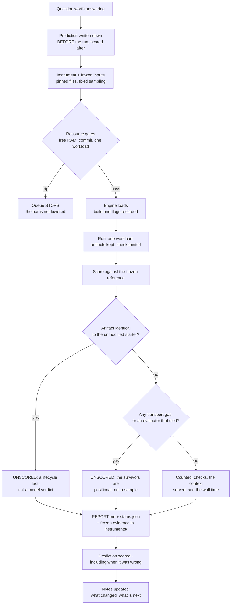
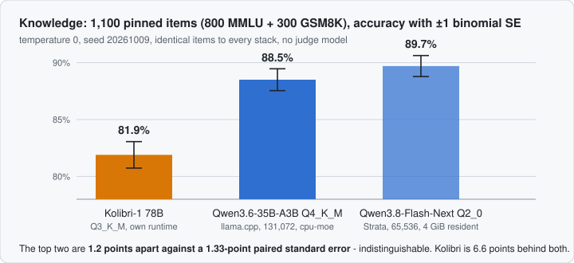
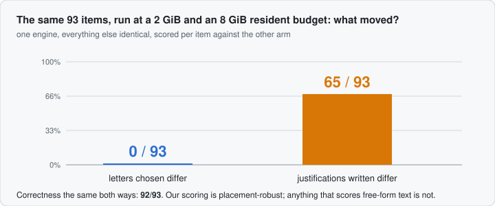

# local-llm-lab

Field notes from running large language models on one ordinary desktop - 64 GB DDR5, an RTX 5070 with
12 GB, two NVMe drives, Windows, no Docker - and measuring, rather than guessing, what fits, what is fast
and what each model actually scores. Every number here came from a run on this one machine, and every
claim carries the instrument that produced it.

Two habits are worth knowing before you read a number. A **prediction is recorded before each run and
scored afterwards, including when it is wrong** (that is what [section 4](#4-what-we-got-wrong) is), and a
run that cannot be scored is reported as **unscored, never as a zero**. Both habits exist because both
have been violated here, and every correction is kept in the open.

**Start here:** [1. What we would run today](#1-what-we-would-run-today) |
[2. How to read any number here](#2-how-to-read-any-number-here) |
[3. The numbers](#3-the-numbers) | [4. What we got wrong](#4-what-we-got-wrong) |
[5. Where the numbers come from](#5-where-the-numbers-come-from) |
[6. The mechanics](#6-the-mechanics)

The last fifth of this file is **September 2026 history** - the harness essays and the recommendation for a
32 GB box - collected under one heading, [Background and history](#background-and-history-september-2026).
Nothing there is a current recommendation, and the Reports index at the end is split the same way.

This is a working lab notebook, not a product. Numbers are from one machine - "DARKTEXAS" is what this box
is called - so treat them as directional. Licence:
[FSL-1.1-MIT](#license) - source-available, **not** OSI open source.

## 1. What we would run today

Distilled from the nine-battery suite (693 checks: events, ledger, paths, ledger2, repo, longctx, repo2,
perf, longctx2) on this box. Each line is a measurement with its run behind it; the [dated reports](#reports)
carry the tables.

- **Best local configuration: Qwen3.6-35B-A3B Q4_K_M on llama.cpp, provisioned** - context 131,072,
  reply cap 32,768, thinking budget 6144, MoE experts on the CPU (`--cpu-moe --load-mode none`).
  **414/414** on the ranking metric, **565/565** on the six-task suite, **692/693** on all nine - one of
  the two best results recorded here, tying the next entry cell for cell, at 1,300-2,700 s per full sweep.
- **A streamed low-bit giant ties it, and is cheaper in RAM.** Qwen3.8-Flash-Next Q2_0 served by Strata -
  a streaming inference engine, not a model - from disk with a 4 GiB resident budget also scores
  **414/414 and 692/693**, cell for cell, and answered a 1,100-item knowledge set **31 % faster in wall
  time** (2,128 s vs 3,078 s). On a 12 GB card that is a real option, not a toy.
- **What the two stacks know: the same.** 88.5 % vs 89.7 % over 1,100 MMLU + GSM8K items - a 1.2-point
  gap against a 1.33-point standard error - and the expected low-bit *recall* penalty did not appear.
  Run a knowledge benchmark before claiming a model is "smarter".
- **Rank on the batteries that discriminate, and read `repo2` beside them.** `events` (76) and `paths` (75)
  are saturated - they split on 5/76 and 3/75 checks across the whole top group - so the metric is the four
  batteries with repeats behind them: `ledger + ledger2 + repo + longctx` = **414 checks**. The other three
  of the nine (`repo2` 55, `perf` 33, `longctx2` 40) are single-sample batteries, so they are reported
  next to the metric rather than folded into it. `repo2` is the one that still separates: 34-48/55 for
  everything except the two leaders at 54/55, whose single miss is the same check.
- **Report each model at the context it can afford, and say which.** 131,072 for the six local models;
  **32,768 for Swift Bonsai 2**, which trips the 0.5 GiB GPU floor during load at 65,536 and above;
  65,536 for Strata. Nothing measured shows the raised context costing a battery.
- **The biggest lever measured on this box is the expert cache, and it is on the GPU side of the ledger.**
  On a staged llama.cpp **b11480** (the first build with `--moe-cache-mib`, PR **#29887**) with
  `--cpu-moe --load-mode none`, decode runs **47.4 / 45.3 / 45.7 / 58.6 / 66.8 / 78.3** tok/s at the
  **0 / 256 / 512 / 1024 / 2048 / 4096 MiB** rungs - **+65 % at 4,096** - with the reasoning letters
  **90/93 at every rung**, so it buys rate and moves no answer. The shape matters as much as the endpoint:
  **nothing to 512 MiB** (at or below no cache), a knee between 512 and 1024, then a near-linear climb, and
  **prefill gains first** (72 -> 101 tok/s by 512 MiB) while decode gains last. Two conditions on the number:
  **assert engagement** - b11480 logs *no* MoE-cache line, so the knob is silent and VRAM per rung (+264 /
  +1,034 / +4,106 MiB, within 10 MiB of the request) is the only proof it is live; and **name the build** -
  b11480 is **LRU**, while **#30637** made it 50/50 SLRU from **b11732**, so this ladder does not transfer.
  At 4,096 the card sits at **11,335 of 12,227 MiB**, so the next rung is a VRAM-floor question, not a rate
  question. Source: `../ai_bench/queue-20261016-shortlist/q2-moe-cache-ladder-20261020.md`.
- **On the Strata track the biggest lever is one config line: `--kv-resident 32768`.** With `--kv int8`,
  `--max-context 65536` and `--resident-budget-gib 2` fixed, keeping KV in VRAM moves the engine's own
  per-request rate from a **median 7.6 tok/s to 69.1 tok/s** (94 requests per arm, distributions not
  overlapping), and a standalone repeat gave **83.0** - **9-11x decode**, with the reasoning letters
  **92/93 in every arm-run**. The flag cannot be passed through the server wrapper (`serve/server.py` never
  mentions it); it belongs in the config's `args` array. **It is conditional on an idle box:** the same arm
  measured **8.1 tok/s** on 2026-10-16, 42 seconds after a 12,838-second Colibri run ended, and the streaming
  control measured 7.2 that day and 7.6 today - so the streaming arm is insensitive to machine state and the
  resident arm is not. State the prior workload with any Strata rate. Source:
  `../ai_bench/queue-20261016-shortlist/q1-kv-residency-20261020.md`.
- **The cache ceiling is a floor value, not a flag value - and the engine clamps rather than refuses.** Ask for
  more than fits and llama.cpp silently grants what fits and serves: a **6,144 MiB** request on this card
  allocated about **5.6 GiB** and left **405-429 MiB** free, which is **89-91 tok/s** but **below the 0.5 GiB
  GPU floor**, so it runs and is not admissible as a lab row. The largest admissible rung is **5,376 MiB**
  (**683 MiB** free, **~83 tok/s**, +75 % against the cache-off control), with 5,632 already failing the floor
  (453 MiB) and 5,120 (911 MiB) safely under it. So: climb to the floor, stop before it, and **say when a run
  was clamped**, because a clamped rung's cache size is not the number in the flag.
  Source: `../ai_bench/queue-20261016-shortlist/q2c-cache-ceiling-20261020.md`.
- **Thread count stops mattering once the cache is on.** Same build, same flags, only `-t` different,
  interleaved direction, n=2 per arm: **+3.5 %** at rung 0 (**t=8 48.80 -> t=16 50.50** tok/s) but **+0.5 %**
  at rung 4096 (**76.51 -> 76.86**). The expert cache takes the work off the CPU, so the extra threads have
  nothing left to parallelise - and at rung 0 the 3.5 % is **inside the arm's own 5.6-7.9 % spread**. `-t 16`
  is therefore not a general default for CPU-MoE runs; `-t 8` remains fine where the cache is on.
  Source: `../ai_bench/queue-20261016-shortlist/q2b-thread-rerun-20261020.md`.
- **The decision track: a 4B and a 9B inside one point, and the RAM upgrade changed nothing.** On
  Bespoke's published 3,880-record suite `nimble` 9B leads `kev4` 4B on the 13-subset macro (0.7565 vs
  0.7442) and on the class-balanced macro (0.7445 vs 0.7395), but **paired, both differences cross zero**
  (95 % CI [-0.0257, +0.0015] and [-0.0189, +0.0092]). Pooled record-level nimble is ahead (McNemar
  p = 0.0058), and by family it is nominally ahead in all three - noul +1.5 (p = 0.20), choice +1.6
  (p = 0.06), score +3.3 (p = 0.13) - yet no family comparison is significant. The binary family even
  splits by metric: nimble +1.1 on accuracy, **kev4 +0.8 on balanced accuracy**. Re-measured after the
  upgrade, all **7,760 records are identical** to the pre-upgrade run, so the suite is platform-invariant.
  Report balanced accuracy, the prediction rate and the majority baseline for skewed subsets, and
  `mean |prediction - target|` for the score family (nimble 0.727, kev4 0.787, lev 0.856, kev0 1.090,
  laya 1.224). Sources: `bespoke-metric-20261010/`, `bespoke-suite-20261010-v1/`.
- **The fastest models fail the hard axes; the fastest *successful* one is not the fastest.** On their
  first sweeps: gpt-oss-20b at 159 s/task but `repo` **0/78** - which is also the starter's own baseline,
  so read it as the suspected lifecycle failure [§2](#2-how-to-read-any-number-here) describes rather than
  a measured limit - and `longctx` 15/40; MiniCPM5-2B at 176 s/task and 122 tok/s with `repo` 43/78. Both
  later reached 377 and 374 on the ranked metric, gpt-oss scoring `repo` 78/78 on a repeat, which is
  exactly the volatility the noise rule warns about and a reason to read any single row of the table in
  [§3](#3-the-numbers) as one sample. The fastest configuration that passes *everything* is Qwen3.6 +
  provisioning at 274 s/task.

Read the numbers in this section the way [§2](#2-how-to-read-any-number-here) says to: the 1-check tie
between the top two, and the 3-check gaps beneath them, are **inside this lab's own noise floor** - they
rank the field, they do not separate it.

## 2. How to read any number here

The process is the product. Every measurement in this repo went through the same loop, and the branches -
not the happy path - are what make the numbers comparable.

- **A prediction goes in before the run and is scored after it.** Every item in the overnight queues has
  its question and its prediction written into `REPORT.md` *before* the engine starts, and the morning
  scores them. Three of the entries in [section 4](#4-what-we-got-wrong) are predictions that failed.
- **One inference workload at a time, and the gates are checked rather than lowered.** 9 GiB free
  physical / 8 GiB commit / 0.5 GiB GPU free before an item, 3 / 2 / 0.5 GiB at runtime. A trip **stops**
  the queue and says so in `status.json`; it never lowers a bar to keep going. The drivers now also refuse
  to start while another measured run holds the inference slot.
- **Compare inside a run, never across runs.** A sweep's rows were produced under one engine build, one
  context, one set of flags; a number from a different session is a lead until it is re-measured here.
- **Know the noise floor before believing a difference.** On the discriminating battery, `ledger2` has
  spanned **19 checks** across six runs of one model (and 14 across five runs of another), and `repo` has
  swung **0-78** on the weakest two. Single-run `ledger2` differences below ~19 checks are noise.
- **Unscored is not zero.** Three distinct ways a run yields a number that is *not* a model verdict: the
  artifact equals the starter's (nothing was written), a transport gap leaves positional survivors, or the
  evaluator exited abnormally. All three are labelled in the record rather than counted as failures.
- **Other people's numbers are leads. Only this box's runs are evidence.** Vendor claims, community
  reports and papers are quoted with their source and treated as leads - the lab's news scans tag each one
  `status: lead` in those files. Several have been contradicted by a run here, and one of ours was
  contradicted by theirs: see [section 4](#4-what-we-got-wrong).

- **Before believing a low score, check it against the starter.** A score equal to the unmodified
  starter's baseline (events 2/76, ledger **7/70**, paths 9/75, ledger2 **62/226**, repo **0/78**,
  longctx 1/40, repo2 0/55, perf 1/33, longctx2 0/40) means the session **never wrote the file** - a
  lifecycle fact, not a model verdict. Four published readings were corrected by this rule. Hash the
  artifact against the starter to settle it; `clean_finish` cannot tell you.
- **`clean_finish`, `exit 143` and `quota_unknown` are not failures** - all three appear on 70/70 runs.
  Correctness is `evaluation.passed`, and a session killed at its wall *after* the artifact was complete
  still scores full marks.
- **Run repeats before concluding anything.** One model has produced 62-226 on `ledger2` (a no-op and a
  perfect run), another 144-203, and `repo` has swung 0-78 on one model. Single runs are samples.
- **Use the RTX 5070 and nothing else.** The Arc iGPU does work through Ollama's Vulkan backend but
  delivers **0.39x** the discrete card (100.8 vs 260.5 tok/s) while spilling to system RAM, and the NPU
  has no path in any engine here. The iGPU is at best a second device for small decision/embedding work.
- **Keep the floors.** 9 GiB free physical / 8 GiB commit headroom / 0.5 GiB GPU free before an item;
  3 / 2 / 0.5 GiB during it; one inference workload at a time. A trip is a measurement against the floor,
  not a reason to move it - the one deliberate loosening in this record (a 6 GiB worker-private cap) is
  named in [§6](#6-the-mechanics) with its date, and nothing else has been lowered.

## 3. The numbers

### The ranked batteries

The ranking metric is the discriminating subset - `ledger + ledger2 + repo + longctx` = **414 checks** -
because `events` (76) and `paths` (75) are saturated: they split on 5 and 3 checks respectively across the
whole top group. Each row carries the **context it was actually served**, which is a lab rule: nothing
measured shows the raised context costing a battery, and one model cannot take it at all.

| configuration | context served | ranked metric (414) | all nine batteries (693) |
|---|---|---|---|
| Qwen3.6-35B-A3B Q4_K_M, provisioned (`ext-v12`) | 131,072 | **414** | **692** |
| Qwen3.8-Flash-Next Q2_0, Strata, 4 GiB resident, streamed | 65,536 | **414** | **692** |
| Qwen3.6-35B-A3B (`ctx-v8`, the first provisioned sweep) | 131,072 | 411 | - |
| Kolibri-1 78B (two runs, identical per task) | 131,072 | 400 | - |
| Nemotron (394 and 393 across two runs) | 131,072 | 393-394 | - |
| Swift Bonsai 2, the declared context exemption | 32,768 | 379 | - |
| gpt-oss-20b | 131,072 | 377 | - |
| MiniCPM5-2B | 131,072 | 374 | - |

The two perfect rows are the only ones at 414, and they tie **cell for cell** on all nine batteries: a
20 GB fully-resident MoE and a streamed 2-bit giant that keeps 4 GiB resident.

Three things this table is not. It is **one run per row** (two where a row says so); the battery most of it
rests on, `ledger2`, moves by up to 19 checks between runs of a single model (§2), so the 3-check gaps -
411 against 414, 394 against 393, 379 against 377 - are **orderings, not separations**, and only the top two
against the rest (34 checks and more) are outside the floor. The rows carry **no dates**, because every row
was produced under the pinned builds in §5 and re-running them is what the [reports](#reports) are for.
And the counts are the lab's own checks, not a task-success rate. For scale: the **six-task suite (565)** is
the 414 ranked checks plus `events` (76) and `paths` (75), and the **nine-battery total (693)** adds `repo2`
(55), `perf` (33) and `longctx2` (40).

### What they know

Two stacks, the same 1,100 items, two different engines and weight formats. The headline is in the figure;
the per-topic split, and the one topic whose gap clears noise, follow underneath.

### The same model, served by a second engine

The 1,100 items were asked of a second engine as well: **Colibri v2.0.0** serving the *same*
Qwen3.6-35B-A3B pack on the CPU, streaming int4 experts. It scored **972/1,100 = 88.4 %** - 967 measured
plus 5 recovered by a declared re-ask of the 17 requests the network dropped; 8 arithmetic items remain
unmeasured, so the bracket is 88.4-89.1 %. Against llama.cpp's 88.5 % on the same items that is **0.14
points apart**, far inside the 1.33-point paired standard error.

What differed was cost: **11.4 h against 51 min, about 13x**. And the eight unmeasured items have a
diagnosed cause rather than a vague one - at ~4 tok/s a 1,024-token arithmetic answer needs ~256 s, past the
instrument's 200 s per-request budget, and a single-slot server makes a retry queue behind the abandoned
request instead of recovering.

Knowledge is the invariant across three engines on this box (87.9 %, 88.5 %, 89.7 %); cost is not - the
same items take 1.93 s each on Strata, 2.80 on llama.cpp and ~37 on Colibri.

### Note: knowledge breadth, the top two stacks (measured 2026-10-10)

1,100 pinned items each (800 MMLU over 8 subjects for recall + 300 GSM8K as the procedural control),
sampling pinned at temperature 0 / seed 20261009. This is the lab's first knowledge instrument; before
it, every battery here measured procedural coding/repair.

| stack | overall | MMLU (recall) | GSM8K (math) | wall | per item |
|---|---|---|---|---|---|
| Qwen3.6-35B-A3B Q4_K_M (llama.cpp, 131,072, cpu-moe) | 974/1100 = **88.5 %** | 688/800 = 86.0 % | 286/300 = 95.3 % | **51.3 min** | 2.80 s |
| Qwen3.8-Flash-Next Q2_0 (Strata, 65,536, 4 GiB resident, streamed) | 987/1100 = **89.7 %** | 699/800 = 87.4 % | 288/300 = 96.0 % | **35.5 min** | 1.93 s |

Per-subject, in case a topic matters to you:

| topic | Qwen3.6 | Strata Q2_0 | reading |
|---|---|---|---|
| astronomy | 95/100 | 96/100 | tie |
| high-school geography | 90/100 | 90/100 | tie |
| world history | 90/100 | 91/100 | tie |
| philosophy | 90/100 | 91/100 | tie |
| world religions | 86/100 | 89/100 | tie |
| international law | **93/100** | 90/100 | tie (Qwen3.6 nominally ahead) |
| **prehistory** | 86/100 | **94/100** | **Strata ahead - the only gap that clears noise** (~1.9 se) |
| **virology** | **58/100** | **58/100** | a ceiling in the items, not a model property |
| grade-school math | 286/300 | 288/300 | tie |

**The honest read: Strata is nominally ahead, not established ahead.** 13 items = 1.2 points overall
against a **1.33-point standard error**, with MMLU +1.4 and GSM8K +0.7 - all inside one se. What *does*
clear noise: the **wall time** (15.8 min, 31 % faster) and the **prehistory** topic. Meanwhile my
recorded prediction for this test was wrong in an interesting way - I expected ~2-bit weights to cost
*recall* first, and MMLU came out 87.4 % vs 86.0 %, i.e. no measurable penalty.

So **do not choose between these two on knowledge** - at this sample size they know the same things.
Choose on **cost and operation**: Strata served all 1,100 items in 35.5 min with only ~4 GiB resident and
66 GB on disk, while Qwen3.6 took 51.3 min and needs the whole ~20 GB MoE reachable through `--cpu-moe`,
i.e. system RAM - which is exactly why that recipe does not transfer to a 16 GB box.

### Note: the same tie, expanded (measured 2026-10-10)

A recognition tie does not mean they can *explain* the topic, so the pair were re-tested on the subject
they are most tied on. Design: the 8 shared-correct astronomy items that mention **Mars** (of 93
shared-correct astronomy items overall), a 25-fact list, and a ~550-word paper at three repeats; scored
against a pinned Wikipedia corpus (12 Mars-science pages, 63,297 words, sha256 `05e8091a…`); temperature
0, seed 20261009, fully local verification, no judge model.

| form | Qwen3.6-35B-A3B Q4 | Strata Qwen3.8-Flash-Next Q2_0 |
|---|---|---|
| reasoning on 93 shared-correct items | 90/93 (96.8 %) | **92/93 (98.9 %)** |
| 25-fact list, grounded | 25/25 | 25/25 |
| facts carrying figures | **16** | 8 |
| paper length (target ~550) | 408 words | 424 words |
| paper grounding | 0.86 | **0.98** |
| distinct paper topics over 3 repeats | 1 | 2 |

**Reasoning: no difference, now measured on 93 items rather than 8.** Asked for the answer plus the
decisive fact and the rejected distractor, Qwen3.6 scores 90/93 and Strata 92/93 - 1 discordant pair one
way, 3 the other, paired McNemar **p = 0.625**. Qwen3.6's three misses share one signature: it derives the
correct value and then states a different letter (item 66 derives 25x, answers A = 100x; item 74 derives
2.537 million light-years, answers B; item 90 derives 2.175x10^16 kg, answers B), and 74/90 repeat
identically under both prompt variants. A first free-form pass scored 88/93 vs 92/93 (p = 0.219) because
the extractor read the option the reply opens by *quoting* ("A. 4:1 ... D is actually the correct
answer"). Requiring `ANSWER: <letter>` fixed it - 186/186 replies then parsed unambiguously, and the
item-level picture got sharper, not just cleaner. **Most of that 4.3-point raw gap was my scoring
convention, not the models.**

**What is solid:** neither stack fabricated entities or figures. Every one of the 25 facts on each side
was grounded, and the three figures my exact-check flagged were hand-verified as two correct facts absent
from the corpus (Perseverance 1,025 kg; Phobos 22.4 km) and one slightly off (Mars "4,217 miles" vs
4,212). The exact-figure check is a **flag for human review, not a verdict**. Separately, Qwen3.6 returned
a byte-identical paper three times while Strata returned two different papers from the same pinned
request - an independent cross-check of the lab's earlier note that temperature 0 is not seed-stable on
that engine. **That note now has a mechanism and a version boundary:** Strata 0.2.5 (2026-10-25) replaced a
prompt-path choice made from measured round times with one made from prompt length - *"the old timing guess
changed answers between runs"* - so every such reading taken before engine 0.1.50 is non-deterministic **by
policy**, and only a row that names the engine version can claim otherwise
([2026-10-25](NEWS-2026-10-25.md)).

**Limit:** these checks measure grounding and figures, not truth, argument quality or whether the prose is
worth reading. [DEEP-SCORECARD.md](instruments/new-items-20261007/DEEP-SCORECARD.md) holds both stacks' facts lists and full papers
relabelled A/B for blind human scoring; the mapping is in the result JSONs. Instrument design, every
pass, the parse lesson and the caveats: [KNOWLEDGE-DEEP-2026-10-10.md](KNOWLEDGE-DEEP-2026-10-10.md).

### What placement changes, and what it does not

This is the measurement that says which instruments are trustworthy. The same 93 items, the same engine,
the same prompt, at a 2 GiB and an 8 GiB resident budget: **65 of 93 justifications differ, 0 of 93 chosen
letters**, and correctness is 92/93 both ways. So a battery that scores an answer or an artifact is
placement-robust, and anything that scores *prose* - papers, fact lists, free-form reasoning - needs
repeats before a difference means anything. That is the whole reason the ranking metric counts checks and
not text.

## 4. What we got wrong

The corrections are the most useful part of this notebook, because each one names a way a benchmark can
lie. Every entry here was a claim *this lab* made and then refuted with its own runs.

- **"Strata's 2-bit weights will cost recall first."** Predicted a recall penalty; measured MMLU
  87.4 % vs 86.0 % for the 4-bit stack, i.e. no penalty at all, with GSM8K 288 vs 286. The quantisation
  cost did not land where the intuition said it would.
- **"The free-form reasoning gap is 4.3 points."** Most of it was our own scoring convention: the extractor
  read the option a reply *quoted* while explaining why it was wrong. Requiring `ANSWER: <letter>` made all
  186 replies parse unambiguously and moved the pair from 88/93 vs 92/93 to 90/93 vs 92/93. A parser can
  manufacture a gap as easily as it can hide one.
- **"MTP is faster."** Per token, yes: **+31.2 %** (50.3 vs 38.3 tok/s). Wall clock, no: **-7.3 %**, because
  it emits **+21.7 %** more tokens. Accuracy did not move (plain 219/221/219, MTP 220/219/216, n=3 each),
  so the single pair that had looked like a gain was variance.
- **"Swift's ledger score is 7/70."** It was a reply-cap artifact: the turn used exactly 12,288 of its
  12,288-token allowance and never called a tool. At a 32,768 cap the same model scores **70/70** while the
  byte-identical `ledger2` checks stay 226/226 in the same session. A low score has to be checked against
  the reader's limits before it is called a model property.
- **"Kolibri loses 14 checks to the raised context."** Refuted by four targeted repeats: at the *same*
  131,072 context it scores **226/226 twice** when `ledger2` runs first, so the variable was loop position
  or plain variance, not context. Two runs of one cell are not a finding.
- **"There is no upstream flag for the expert cache, so bumping the build cannot get it."** Wrong by one
  day and one build: llama.cpp PR **#29887** merged 2026-10-07T18:07:46Z, `--moe-cache-mib` first ships in
  **b11480**, and our pinned build (b11461, published 06:50:53Z the same day) predates the merge by about
  eleven hours. The negative control - *our* build has no such flag - was right; the conclusion drawn from
  it was stale. ([Details](NEWS-2026-10-16.md), and the note it corrects is
  [STRATA-ALTERNATIVES-2026-10-11.md](STRATA-ALTERNATIVES-2026-10-11.md).)
- **"#27149 is an unmerged PR."** It is a **Discussion** (`pulls/27149` 404s). The findings quoted from it
  stand; the artefact type did not.
- **A knowledge run that scored 0/1100 - and exited 0.** Every one of the 1,100 requests was a `404`,
  because the engine advertises its model as `qwen3.6-colibri` and the instrument was told `qwen36-35b`.
  The run took 12.9 s and looked like a very bad model. The item now reads the model id from the engine's
  own `/v1/models`, and the instrument marks a run with any transport gap **unscored** and exits non-zero.
- **A 9.3 % that was not a score.** 102/1100 came from an instrument orphaned by a driver timeout plus an
  engine that had been stopped underneath it: 989 failures were connection errors and the 111 that answered
  were simply the items that ran first. Positional survivors are not a sample.

- **"The expert-cache ladder is non-monotonic, peaks in the low thousands, and the control runs at 35-40
  tok/s."** Refuted on all three clauses on 2026-10-20: the curve is monotone after a dead zone, the control
  runs **47-50 tok/s**, and the **top rung wins by 65 %**. The lesson is not that a prediction was wrong but
  that the shape was guessed from intuition ("more cache must eventually hurt") with nothing behind it - the
  rung that mattered was the one nobody predicted.
- **"A ladder measured in rung order is a ladder."** It is not, if every rung re-reads the same 20.4 GB file:
  the Windows file cache warms across rungs and manufactures a rising curve. Measured, and the reason the
  finding survives: a warm-file-cache rerun of the two endpoints gave rung 0 **50.25 / 50.13** against cold
  **47.44** and rung 4096 **79.39 / 81.17** against **78.28** - a **6 %** artifact against a **65 %** effect.
  The control is now part of the item, not an afterthought.

- **"An over-sized `--moe-cache-mib` is refused at load."** It is not: a 6,144 MiB request on a 12 GB card
  **came up in 11.6 s** and served at 89-91 tok/s, having silently granted about 5.6 GiB. Predicted a CUDA
  allocation error and no listening server. The general lesson: a flag that names a resource *request* is not a
  flag that names a resource *allocation*, so the loaded configuration has to be read back from VRAM rather
  than trusted from the command line - and a clamped run has to say so, because its cache size is not the
  number in the flag.

- **"`--kv-resident 32768` does nothing: 7.3 -> 8.4 tok/s."** That was our own 2026-10-16 measurement, and it
  replicated the *control* perfectly while getting the treatment 8.5x wrong. The same arm measures **69.1** and
  **83.0** on an idle box (n=94 and n=6), against a control that reads 7.2 then 7.6. The experiment had one
  arm taken minutes after a 12,838-second run finished; nothing in the flags, the pack, the build or the log
  parsing differed. The lesson is not "re-measure when you dislike the answer" but that **a rate measurement
  inherits the machine's prior workload**, and this lab's one-workload rule has a second half: record what ran
  *before* the measurement, not only what runs during it.
- **A stale `status.json` read as a fact.** I declared this item "never started" because the queue's status
  file listed only q4 - while the same root's `REPORT.md` and `AGENTS.md` both recorded q1 finishing on
  2026-10-16. The dry-run line had been appended above the real run block. Status files are bookkeeping;
  the per-item report block and the dated entries are the record, and a claim about what ran has to come from
  the highest-authority source available, not the most convenient one.

### Tried, and it made no difference

Kept because a null result is a measurement, and because the next person will otherwise spend the same hours:
these were run properly and changed nothing we would recommend.

- **Moving the decision model to a different loader.** Laya on Colibri `/v1/systemone`, on llama.cpp b11429, and
  now on **Ollama 0.40.6's native `--ask` path**: **14/18 with 0/4 stalls caught and 0/14 false alarms in all
  three**, and the probabilities agree to **0.0168 max / 0.0052 mean**. Six engine-and-model combinations sit
  at 0/4 - the signal is absent from the models, not from the plumbing. The move did produce one usable fact:
  the CLI's *verdict* is a far looser operating point (**"yes" on 14 of 18 windows = 4/4 caught, 10/14 false
  alarms**, where the lab's own rule R6 gets 4/4 and 1/14), so its confidence, not its answer, is the
  interface. Source: `../ai_bench/ollama-decision-20261020/REPORT.md`.
- **The two smallest cache rungs.** 256 and 512 MiB are **at or slightly below** the no-cache control (45.3 and
  45.7 against 47.4), in both the cold pass and the warm rerun. Below the knee the cache costs more than it
  saves; do not bother with rungs under 1 GiB.
- **Doubling the thread count.** +3.5 % where the cache is off (inside the arm spread) and +0.5 % where it is
  on. The 2026-10-19 thread ladder had already shown 8 threads within 6 % of the optimum on this box; this
  shows the same thing in a second configuration.
- **Reading prefill from a warm probe.** The first request after a load reports ~99 tok/s prefill and the
  second 50-60, because the second prompt hits the prompt cache. Any prefill row taken from a warmed request
  is measuring cache reuse. Not a result, an artifact worth not repeating.

## 5. Where the numbers come from

- **The ranked batteries** - nine frozen tasks, 693 checks, generated and scored by the harness in
  `ai_bench/new-items-20261007`; artifacts are scored against a pinned reference, and a score equal to the
  unmodified starter's is treated as a lifecycle fact rather than a model verdict.
- **The knowledge instrument** - 1,100 pinned items (800 MMLU across 8 subjects + 300 GSM8K as the
  procedural control), sampling pinned at temperature 0 / seed 20261009, no judge model.
- **The reasoning instrument** - 93 shared-correct items answered with the decisive fact and the rejected
  distractor, `ANSWER: <letter>` required, paired by item.
- **The decision suites** - Bespoke's published 3,880-record suite, re-measured after the RAM upgrade:
  all 7,760 records identical, so the suite is platform-invariant. See `bespoke-suite-20261010-v1/`.
- **The placement instrument** - the same items at two resident budgets, scored per item.
- **The transcript rule** - stall detection from the transcript (identical repeated outcome), which catches
  **4/4 stalls at 1/14 false alarms** where every neural decision model screened here catches **0/4**.

The instruments, their frozen inputs and the small evidence are snapshotted into this repo under
[`instruments/`](instruments/) with a sha256 manifest and a refresh script, so a claim can be traced back
without trusting the prose.

**Pinned builds** (the ones the numbers above were produced with): llama.cpp **b11461** at
`staged-27b-20261007/llamacpp-b11461`, run with `--cpu-moe --load-mode none`; Strata **0.1.40.3** at
`staged-strata-20261007/engine-src-v0.1.40.3` (0.1.41 was staged and measured neutral on speed, adopted
only for its watchdog and tool-parse fixes); Colibri **v2.0.0** at `staged-colibri-20261011`; Ollama
**0.40.4** installed. Model files, quantisations and their digests are recorded in each frozen root.

### What each battery asks

Nine frozen task sets, 693 checks in all. One line each, because the names are opaque on purpose - they
say what the lab wanted to probe, not what the task is:

| battery | checks | what it asks the model to do |
|---|---|---|
| `events` | 76 | correlate a stream of events into the right groups |
| `ledger` | 70 | parse ledger records and produce the correct totals |
| `paths` | 75 | resolve paths and their ordering |
| `ledger2` | 226 | the same ledger work at fine grain: the 70 checks plus 106 labelled traps and 50 valid random ledgers |
| `repo` | 78 | a five-file cross-module repair - the first orthogonal discriminator the suite produced |
| `longctx` | 40 | read a 235 KB module in chunks and make one minimal, correct edit |
| `repo2` | 55 | the harder multi-file task, where the top group still differs (54/55 for both leaders, 34-48 for everything else) |
| `perf` | 33 | hold a stated wall-clock budget on 2,000,000 intervals - the only battery that prices engineering judgement, since a correct but quadratic answer passes everything else |
| `longctx2` | 40 | find nine planted frame-length sites in the same large corpus |

### A short glossary

| term | what it means here |
|---|---|
| MoE / dense | mixture-of-experts (a few experts fire per token) vs one dense network |
| active parameters | what a token actually touches; this, not total size, decides whether CPU offload is usable |
| `--cpu-moe` | keep the MoE expert weights in system RAM rather than VRAM |
| `Q4_K_M`, `Q2_0`, `IQ1_M` | GGUF quantisation recipes, roughly 4, 2 and 1 bits per weight |
| GGUF | the single-file model format these engines load |
| context window | the most tokens a request may carry; 131,072 here unless a row says otherwise |
| resident budget | how much RAM an engine may hold for weights and cache before it starts streaming from disk |
| commit charge | Windows' accounting of memory promised to processes - the "commit headroom" gate watches it |
| MMLU / GSM8K | a multiple-choice knowledge suite / a grade-school maths suite: the two halves of the knowledge instrument |
| SE (standard error) | the `±` on a rate; a gap smaller than it is not a gap |
| McNemar | the paired test used when two stacks answer the same items |
| MTP | multi-token prediction: a drafting scheme that emits several tokens per pass |
| battery / instrument / probe | a frozen task set / the tooling that runs and scores it / a one-off measurement |
| `starter` | the unmodified files a task begins from; matching it means nothing was written |
| `provisioned` | the declared llama.cpp flag set: context 131,072, reply cap 32,768, thinking budget 6,144, `--cpu-moe --load-mode none` |
| `ext-v12`, `ctx-v8` | run-root names in the lab's working tree, so a table row can be traced to one session |
| the declared context exemption | Swift Bonsai 2 is served at 32,768 because it trips the GPU floor at 65,536 and above |
| Strata | a streaming inference engine (`Niko1221/Strata`) that keeps a small resident budget and streams expert weights from disk; not a model, and unrelated to llama.cpp or Ollama |
| `A3B` | "35B-A3B" reads as 35 billion parameters total, ~3 billion active per token - the property that makes CPU offload usable |
| `--load-mode none` | llama.cpp: do not preload the MoE experts into RAM; let them stream |
| Bespoke | a third party who published a 3,880-record decision suite; the lab re-measured it rather than trusting the tables |
| `nimble`, `kev4`, `kev0`, `lev`, `laya` | small decision models scored on that suite (nimble 9B, kev4 4B; sizes for the others are in the suite's own report) |

One name collision worth stating plainly, because it has confused this lab's own notes: **Kolibri**-1 78B
is a *model* measured here; **Colibri** (`JustVugg/colibri`, v2.0.0) is an unrelated *engine*. They share
no code and no author.

## 6. The mechanics

- **The box:** 64 GB DDR5 (a 32 GB upgrade part-way through; the suites are platform-invariant across it),
  RTX 5070 12 GB, two NVMe drives - `C:` system and a 622 GiB models store on `D:` - Windows, no Docker,
  no systemd, no WSL when a run is measured.
- **The gates:** 9 GiB free physical / 8 GiB commit headroom / 0.5 GiB GPU free before an item; 3 / 2 /
  0.5 GiB during it. A trip stops the queue. The one deliberate loosening in the record - removing a 6 GiB
  worker-private cap that was failing nimble while every system floor passed - is written down with its
  date.
- **How a queue runs:** `queue.json` declares each item with its question and prediction; `runner.py` runs
  them serially, checks the gates between items, clears the engine ports (before the first item and between
  them), honours a `STOP` file, and writes `status.json` and `REPORT.md` continuously. An item's instrument
  **checkpoints** its result every 25 items and can **resume** from that checkpoint, so a wall-clock kill or
  a deliberate pause costs time, not work.
- **What is deliberately not done:** no frozen artifact is edited (a declared re-pin is recorded with
  old -> new digests instead), no app is closed or machine rebooted to free memory, and a benchmark is never
  re-run just because a result was inconvenient.

## Docs in this repo
- [instruments/](instruments/) - the measurement instruments, frozen inputs and small evidence snapshotted out of `ai_bench`, with a sha256 manifest and the refresh script.
- [RESULTS-2026-09-15.md](RESULTS-2026-09-15.md) - Pi, Aider, and OpenCode experiments, compact GGUF variants, and CPU-only measurements.
- [RESEARCH-2026-09-15.md](RESEARCH-2026-09-15.md) - new candidates, popular Hugging Face variants, CPU-only models, and Pi comparison plan.
- [HARDWARE.md](HARDWARE.md) - the exact box and its ceilings.
- [HARNESSES.md](HARNESSES.md) - inference harnesses and agent harnesses, with our findings.
- [OPENCODE-OLLAMA.md](OPENCODE-OLLAMA.md) - deep dive: why opencode "hangs" on local Ollama and the fix.
- [DECOMPOSITION-TEST.md](DECOMPOSITION-TEST.md) - head-to-head: three harnesses build the same 7-part spec.
- [BASELINE-REMOTE.md](BASELINE-REMOTE.md) - how the locals compare to cutting-edge remote (Codex + GPT-6 Astra).
- [HARD-SPEC-TEST.md](HARD-SPEC-TEST.md) - the harder spec where the local model finally slips (8/10 vs frontier 10/10).
- [examples/](examples/) - the actual programs each harness produced, plus the specs and the scorer.
- [transparent-decomposer.md](transparent-decomposer.md) - prompt that makes an agent show its plan and work step by step.
- [MODELS.md](MODELS.md) - local models tried, what fits, the MoE-vs-dense lesson.
- [METHODOLOGY.md](METHODOLOGY.md) - how we benchmark (probes, tok/s, placement).
- [RESULTS.md](RESULTS.md) - the measured numbers.
- [benchmarks/](benchmarks/) - the benchmark scripts.

## How to reproduce quickly

The ranked results above come from llama.cpp b11461 + Qwen3.6-35B-A3B Q4_K_M (provisioned) and Strata
0.1.40.3 + Qwen3.8-Flash-Next Q2_0; those flags, files and digests are in [§5](#5-where-the-numbers-come-from).

For a five-minute smoke that is *not* a ranked configuration - Ollama is the easiest engine to stand up:

1. Install Ollama. `ollama pull` any model in [MODELS.md](MODELS.md); the 14B class runs fully on the GPU.
2. `ollama ps` shows the GPU/CPU split; the API is at `http://127.0.0.1:11434`.
3. Run a probe with the script in `benchmarks/`.

Nothing measured here was produced through that path: it is a way to see the box work, not a way to
reproduce a row of the table.
## Reports

Reports tracked in this repo link directly. Nine link into `../ai_bench/…`, the lab's working tree, which
is **not** this repository, so they do not resolve on GitHub. Exactly one of those nine is mirrored here:
the 2026-10-15 overnight report is also at [`instruments/overnight-20261011/REPORT.md`](instruments/overnight-20261011/REPORT.md).
The two `RECENT-WORK-*.html` reports and the September 23 completion report have no mirror in this repo -
they exist only in the working tree.

**2026-10-26 &middot; [Daily news scan: the prompt chunk is a 2-6x lever the engine now moves silently, and 0.1.50 fixed the regression filed against it](NEWS-2026-10-26.md)**
&ndash; a **24.0 h** window (2026-10-25T14:30Z &rarr; 14:30Z today), and three independent reports land on one
knob: **prefill chunk size**. On an RTX 5090 D 24 GB, **`--prefill-chunk 16384` reads a 7,302-token prompt at
907.9 tok/s against 217.7 at the auto 8192 &ndash; 4.2x** (Strata **#4182**); on Windows, the DSV4.1 path reads
**40-130 tok/s** where the same card and engine on Linux read **1,300-2,200**, and `--set prefill-chunk=32768`
takes it **210-660** at a declared price of **685 experts of VRAM** (**#4219**); and 0.1.50 **silently clamps a
manually set `--prefill` to 512 tokens**, with a second reporter getting 512 while the request is *smaller* than
free VRAM (**#4164**). Our card is under 16 GB, so its post-bump default is **4096 &ndash; the smallest of the
three**. Meanwhile the reporter who filed the layer-split regression says **0.1.50 fixed it** (4x 1080 Ti
**+20 %**; on his weak-CPU rig `--remote-expert-opt` adds **+17 %**), and a second machine's full-surface A/B
finds **no regression** (TTFT &plusmn;0.2 % 4K-191K, a 75-minute soak, 0 engine restarts). Also in the file:
**conversation-cache reuse can fall to zero** two new ways (checkpoint density is bounded by the chunk, and the
deepest checkpoint is short by `<|im_end|>` + `\n`; concurrent prefill loses prefix cache on 0.2.6), the
**DeepSeek pack moved four commits without touching weights** &ndash; a chat-template fix with an offline
in-place patcher and a 0.972 GB vision projector &ndash; and **pack format is now a third axis** on that download
(Strata's Engram reader takes MXFP8/Q6_K/IQ4_NL, so Unsloth's Q5_K Engram does not load while ISTA's does).
llama.cpp merged 22 PRs to **b11900**, and **#31028's "+7 % TG" is withdrawn**: a Qwen3.8-family conversion made
with its merged tensors now **asserts at warm-up** (#31189). The arXiv index **advanced for the first time in
three days** with 192 papers; YouTube was reachable but had no in-window upload, so one 2026-10-12 video was
mined for its recipe.

**2026-10-25 &middot; [Daily news scan: Strata shipped twice, the 2-bit DeepSeek set is smaller than we recorded, and llama.cpp can read V4.1 but not our pack](NEWS-2026-10-25.md)**
&ndash; a **~22.75 h** window (2026-10-24T15:45Z &rarr; 14:30Z today). Strata shipped **twice, both
`prerelease: false`** - **`v0.2.5`** (10:06:04Z, engine + Control **0.1.50**) and **`v0.2.6`** (13:45:25Z,
DeepSeek + Control **0.1.51**, the Qwen engine packages byte-identical at 0.1.50, verified by asset size) - so
**the bump target moved off 0.1.48**, and three of its defaults land on a 12 GB card: **prompt chunks drop to
4096** (*"a cold 8K prompt is 9 % slower"*, agent decode +2 %), **the installer no longer carries an engine**,
and **the prompt path is now chosen by length instead of a timing guess** - *"the old timing guess changed
answers between runs"*, which is the mechanism behind this lab's four-day-old *"temperature 0 is not
seed-stable"* note, and it makes engine 0.1.50 the boundary for any determinism claim. The only same-machine
0.1.48-vs-0.1.50 pair (**#4054**, RTX 3090, identical flags) reads chat decode **86.9 &rarr; 99.0** and agent
**94.4 &rarr; 123.0** with **prefill identical to 0.2 %**, against the reporter's own **&plusmn;15 % cross-day
drift** caveat - so the defensible claim is *"no regression"*, not "faster". **#3965** supplies the day's
strongest evidence line from a second box (**RTX 5080, engine 0.1.49 built with
`CMAKE_CUDA_ARCHITECTURES=120`**): *"the same MTP arm moved **18 %** between sessions"* against a **3.3 %**
drafter effect. The DeepSeek V4.1 pack's README was rewritten today and gives **231.32 / 248.84 / 265.83 GB**
for IQ1_M / IQ2_XXS / IQ2_XS - not yesterday's **239 / 257 / 274 GB** - with **IQ2_XXS now "Recommended"** at
**100.0 %** of base task average, which `[INFERENCE]` puts at **231.7 GiB against `D:`'s 252.8 GiB**. And
**llama.cpp merged native DSV4.1 support (#31086)** while reading the Engram tables **inside** the model GGUF
(`llama-model-loader.cpp` has no `engram` path), so the ISTA pack's separate **110.6 GB** Engram file is a
layout upstream does not open: the "second engine" holds for the architecture, not for the download. Also
**#28633** and the source: **`GGML_CUDA_FA_ALL_QUANTS` is OFF by default and absent from the release
workflow**, so a quantised-KV row must name its binary's FA_QUANTS. **arXiv did not advance** (second frozen
day); **YouTube was unreachable** (WSL lost DNS; no Windows `yt-dlp`) so no video is ranked. Seven items,
cheapest first a **perf-counter read**; the new one is **`--kv k8v4` vs `--kv int8` at a fixed context** with
KV bytes per token read back. Reading only. **The scheduled 07:30 run is this file's own process** - proven by
its parent chain - so the "hung run" recorded on 10-23 and 10-24 was a run diagnosing itself, and nothing is
blocked.

**2026-10-24 &middot; [Daily news scan: Strata puts a 763B model on a 12 GB card, and the memory gaps turn out to be page tables](NEWS-2026-10-24.md)**
&ndash; a **~23.5 h** window (2026-10-23T15:10Z &rarr; 15:45Z today). Strata **`v0.2.4`** (2026-10-24T02:18:52Z)
runs **DeepSeek V4.1-Flash on one 12 GB card and 46-64 GB of RAM** &ndash; this box's shape &ndash; from
`ISTA-DASLab/DeepSeek-V4.1-Flash-1017-GSQ-RCO-GGUF` in **239 / 257 / 274 GB** sets, and its own rows are on our
card: *"RTX 5070 12 GB, 64 GB RAM - about 5 tokens/s (code), 231 tokens/s at 8K"*. **The Qwen engine did not
move**: every `strata-engine-0.1.48-*` asset is re-attached and the app stays 0.2.3, so yesterday's bump target is
unchanged. The two findings that matter more than the release: **#3952** is a same-machine A/B where 0.1.46 at
262K context spends the VRAM reserve (windows captured at **61 &rarr; 49 &rarr; 28 &rarr; 13 &rarr; 0 MiB free**,
then a restart) while **0.1.43.1 reaches 238,735 prompt tokens with zero warnings** &ndash; which means 0.2.3's new
**1536 MiB default masks a regression** &ndash; and **#3321** root-causes a 5x copy gap as **cold page tables**:
**pinned reused 26.3 GB/s, pageable fresh 2.28 GB/s**, against a 26.8 GB/s PCIe probe. llama.cpp merged **22** PRs
to **b11853**, including **#30804 chunked CUDA graphs** &ndash; on a card family where **#27330** documents **Xid
8** and a Windows **`0x133`** crash, with `GGML_CUDA_DISABLE_GRAPHS=1` as the workaround &ndash; and **#30966**
gives the expert cache a **`--moe-cache-cpu-share`** knob (**23.5 &rarr; 64.5 tok/s** on a 2080 Ti) while
**#30594** would read **Strata's own `.strp` profile format**, of which this lab holds a learned file. **arXiv did
not advance: zero new listings.** Seven ranked items, cheapest first a **perf-counter read**; the cheapest new one
is a **pinned-vs-fresh copy microbench**. Reading only. **The 07:30 run hung again** (`0x00041301`, PID 270136,
3.2 s of CPU in 7.4 h), so tomorrow's run will be skipped until it is ended.

**2026-10-23 &middot; [Daily news scan: Strata ships 0.2.3/0.1.48 with a measured row on this card, and the test-start failure turns out to be a pagefile](NEWS-2026-10-23.md)**
&ndash; the first full-day window in three (**~22.5 h**, 2026-10-22T16:20Z &rarr; 15:10Z today), and it contains
two releases: Strata **`v0.2.3`** (2026-10-23T07:44:52Z, engine packages **0.1.48**) and **`v0.2.3.1`**
(13:45:22Z, Control 0.1.48.1, no engine change). The claim that matters here is on our card: *"On an RTX 5070
12 GB PC (Gyro-S, first-reply speed, 5 rounds, median): the app's Work profile now uses 5 CPU workers and keeps
1536 MiB of video memory free, and the answer speed rose from 31 to 45 tokens per second"* &ndash; an
**app-default** change against 0.2.1, not an engine decode row. The bump gate closed from the vendor's side:
**#3683 closed** by *"raising the page file (commit-limit warning) and `--vram-reserve-mib` 700 -> 1536"*,
which is the **commit headroom** ceiling this lab measured on 2026-10-22, now shipped as the default. Two new
declaration items came with it: **#3813** (MTP/spec verify dies with CUDA 717 on **every** engine 0.1.41-0.1.48,
*"request #1 succeeds and request #2 fails"*) and **#3844** (`--spec 5` += +6.1 % on an sm_120 5060 Ti, but
`tune_knobs` caps at **[3, 4]**). The mlock fix's tag boundary is now exact rather than approximate: **b11826**
is the first tag containing `#30926`, newest **b11838**. llama.cpp merged **14** PRs, none on MoE or VRAM, and
the one on our axis is **#30663** (DFlash2 drafts now sample). **#30987** closed with the day's best mechanism:
with `--load-mode none`, CPU-kept experts occupy **GTT**, so it OOMs *"while VRAM stayed not full"* &ndash; the
**AMD twin of the WDDM shared segment**, a third ceiling no number the engine sizes itself from can see.
**Ollama `v0.40.9` is stable** and carries **`d3` decision models (2B/4B/9B/27B)** plus **Flint on Linux and
Windows**; **arXiv advanced a full day** with **222** new cs.CL/cs.LG listings, including a paper whose
conclusion is this lab's own rule &ndash; *"a reported speedup is not a portable property of a technique alone
but a joint function of technique, runtime, hardware contract, and workload regime."* **[RD] returned HTTP
403** to every endpoint (recorded as unreachable, not empty), **[HN]** had zero local-LLM stories in 22.5 h,
and **[YT]** produced one mineable 2026-10-09 video whose MTP claim is runnable on staged weights. Seven ranked
items, cheapest first a **perf-counter read**. Reading only. **The 07:30 scheduled run hung and is still
alive** (`0x00041301`), which will skip tomorrow's run until it is ended.

**2026-10-22 &middot; [Daily news scan (second run): the mlock fix merged, and the WDDM ceiling now has a number, a fix and a cliff](NEWS-2026-10-22.md)**
&ndash; a **2.5-hour** window on top of the morning's file, and it contains the one unblocking merge: llama.cpp
**#30926 "Fix #30793"** merged **14:00:59Z** (one file, **+14/-6**, zero comments) and **#30793 closed
14:16:22Z** &ndash; it locks **every distinct buffer a tensor was allocated in**, i.e. each chunk of a >4 GiB
split host buffer, instead of skipping `mlock`. The reporter confirmed it 19 hours before it merged, and the
newest tag **`b11819` (12:53:52Z) predates the merge by 67 minutes**, so the item becomes "run one tag
**>= b11820**" and declares **first-request TTFT before any warmup** plus **RSS at load** (residency moved:
~300 GB &rarr; ~270-280 GB, faulted back in during the first prefill). The **WDDM ceiling** from the morning's
file now has both sides measured: Strata **#3725** sizes its pinned complement from **commit capacity**, which
cannot see the shared segment, so **14.81 GiB pinned then a 26 KB `cudaMalloc` fails** and the message names
the token buffer; a DXGI `QueryVideoMemoryInfo(NON_LOCAL)` clamp to **10.97 GiB** is READY in **25 s**. And the
same class has a **measured cliff**: one engine lost its **entire 64.69 GiB** resident copy to a **~1.3 GiB**
plan shortfall, taking decode from **50-61 tok/s to 2.4 cold / 8.3 warm**. Two first-party GGUFs were created
**six seconds apart** &ndash; Flint (**21.78 GiB** Q4_K_M) and `Qwen3-Coder-30B-A3B-Instruct` (**16.75 GiB**
Q4_K_M, in a class we already screened at 204/221 and measured at 34-36 tok/s), which is the **cheaper** new
row. **Colibri corrected**: the merges are on `dev`, `main` has not moved since **2026-10-17**, so the ref a
probe builds from is now a declared variable. **arXiv did not advance** (zero 10-22 listings), two unread
papers sit on our axes, **[YT] produced no upload in 24 h**, **[HN] one story in 36 h**, and **[RD]** three
symptoms none of which survives a local test. Seven ranked items, cheapest first a **perf-counter read**.
Reading only.

**2026-10-22 &middot; [Daily news scan: the decode regression is in the server, not the engine, and the KV byte is the context cost](NEWS-2026-10-22a.md)**
&ndash; the beat is **broadened on Kevin's instruction** and every item is labelled **VRAM**, **MODEL** or
**ENGINE**, with a measured report preferred to an announcement. Two corrections of the previous file's own
headline: a **crossed server x engine test** on sm_70 (four combinations, same box, pack and argv) moves the
decode number **only when the server version changes** &ndash; 0.1.44.1 server + 0.1.47 engine **134.4 tok/s**
against 0.2.2 server + 0.1.44.1 engine **96.4** &ndash; and on **sm_89 + Windows 11** the loss does not
reproduce at all, the earlier -18 to -31 % having been the **App-bundled engine 0.1.45.3**. So a bump splits
into **engine (safe) and server (20-30 % on one box)**, both declared and read back. **Flint left the Mac**:
`ggml-org/Flint-GGUF` was created today with a **22.3 GiB Q4_K_M** of an Apache-2.0 **40B / 2.5B-active,
262K-context** model, on a llama.cpp merge from the night before &ndash; and that PR reports its **adaptive
expert-activation scaling costs 10-30 %**. The two issues that decide the blocked reference-model item both
landed: **Q4_K down-projection experts are refused** by the qwen36 path (**our staged pack's quantisation**,
112/256 experts and **133.9-154.7 tok/s** once patched) and **fp32 KV at 45 KB/token** caps context, with a
measured int8 prototype (3.56x fewer bytes, **28.4 &rarr; 99.3 tok/s** at 56K). On the widened VRAM axis:
**WDDM's pageable-locking pool is about half of RAM** (13.77-13.82 GB measured on a 32 GB box), free VRAM
creeps **2-6 MiB per long cold prompt** with no allocator to explain it, an auto layer split that leaves
**68 MiB** ends the engine, and **our card already has a vendor-measured matvec row**, which closes an idea
before it was queued. Seven ranked items, cheapest first a **one-minute GGUF header read**. Reading only.

**2026-10-21 &middot; [Daily news scan: 0.1.46 does not recover the decode loss on three architectures, and Strata's own speed numbers were three different measurements](NEWS-2026-10-21.md)**
&ndash; the file's first job is to **correct yesterday's headline**. **#3252** went 7 &rarr; 11 comments
with **three architectures** saying the same thing: **sm_86 RTX 3080 Ti 12 GB (our VRAM class) &minus;11 %
for 0.1.46 vs 0.1.45.3**, **sm_80 A100 &minus;15 % vs 0.1.44.1** with both suspect switches dead inside
&plusmn;5 %, and **sm_75 Linux &minus;6.7 to &minus;9.7 %** &ndash; where yesterday read one sm_120 table
as "not a speed change". **The only named mechanism is Linux-only** (with the 0.2.x file-tier defaults
off, 0.1.46.2 equals 0.1.42 within &plusmn;1.3 %), so a Windows bump is a genuine test of exemption.
**Strata v0.2.2 / engine 0.1.47** (feed `sequence` 107) also **audits its own speed numbers**: an agent
turn read **632 tok/s** in 0.2.0-beta against a real **50-75**, and some surfaces divided by the whole
request, reading **about half** &ndash; so never quote a Strata rate from a UI surface. **MTP never fires
on Windows on the qwen36 path** (**`drafts accepted 0 of 0`** against 73 % on Linux), with the
expert-placement bug traced to a clamp at **`q36_engine.cu:2897`** and **fp32-only KV** that refuses
`--kv` (**#3303**, **#3508**). New in the decision track: **H2O-Lightning-4B merged into
`llama-server`'s own `/v1/systemone`** (231 tasks, **2.4e-6** agreement; the wrong *type* moves
probabilities by **up to 0.33**) and **`pplx-decider`**, a 27B model whose library page claims
**85.7 % vs Jev's 84.5 %**. **Ollama promoted 0.40.7 to stable by renaming the tag**, keeping
`published_at` &ndash; so that field is not evidence a new build shipped. **Colibri merged 21 PRs
post-`v2.0.0`**, which turns our probe into a build. Seven ranked items, the "nothing moved" list, and
no download, engine, inference or benchmark. Reading only.
**Corrected the next day:** the -10 % class is **not architecture-dependent** &ndash; a crossed
server x engine test puts it in **`serve/server.py`**, while engine 0.1.47 is flat to slightly better, and
on **sm_89 + Windows 11** it does not reproduce at all. See [2026-10-22](NEWS-2026-10-22a.md).

**2026-10-20 &middot; [The cache ceiling is a floor value, and the engine clamps rather than refuses](../ai_bench/queue-20261016-shortlist/q2c-cache-ceiling-20261020.md)**
&ndash; the rung above 4,096, asked as a floor question. A **6,144 MiB** request does **not** fail: it comes up
in **11.6 s** and serves at **89-91 tok/s**, having silently granted about **5.6 GiB** and left **405-429 MiB**
free - faster than anything admissible, and **below the 0.5 GiB GPU floor**. Sweeping the rungs against the
floor gives the operative answer: **5,120 MiB -> 911 MiB free, 5,376 -> 683 MiB free (~83 tok/s, +75 % over
cache-off), 5,632 -> 453 MiB free (fails)**. So the largest admissible rung is **5,376**, the ceiling is set by
the floor and not by the flag, and any clamped run must be labelled as clamped. Prediction scored **1/3** -
the refusal I expected never happens, which is the part worth keeping. Idle-VRAM baseline differs between
sessions (831 MiB clean vs ~1,982 earlier), so compare engine-only figures across days.

**2026-10-20 &middot; [KV residency is a 9-11x decode lever, and 2026-10-16 measured it as nothing](../ai_bench/queue-20261016-shortlist/q1-kv-residency-20261020.md)**
&ndash; a replication that contradicted its own predecessor and then explained it. `--kv-resident 32768` at a
fixed 2 GiB budget: **7.6 &rarr; 69.1 tok/s** median decode (94 requests per arm, no overlap), repeat at
**83.0**, letters **92/93 in all four arm-runs**. The control reproduced across dates (7.2 then 7.6) while the
treatment moved **8.5x** - because the 10-16 arm ran **42 seconds after a 12,838-second Colibri run**, so the
lesson is that a rate inherits the machine's prior workload. Also records my own error: I declared the item
"never started" from a stale `status.json` while `REPORT.md` and `AGENTS.md` both had it as run.

**2026-10-20 &middot; [16 threads against 8: real at rung 0, absent where it matters](../ai_bench/queue-20261016-shortlist/q2b-thread-rerun-20261020.md)**
&ndash; the follow-up that prices the one inherited setting inside today's own result. Same build (**b11480**),
same flags, **only `-t` different**, order forward then backward, n=2 per arm: **+3.5 %** at rung 0
(**t=8 48.80 &rarr; t=16 50.50** tok/s) but **+0.5 %** at rung 4096 (**76.51 &rarr; 76.86**) - the expert cache
takes the work off the CPU, so the extra threads have nothing left to parallelise. Prediction scored **4/4**.
The caveat that keeps it out of the recommendations: at rung 0 the 3.5 % is **inside the arm's own 5.6-7.9 %
spread**, so resolving a cache-off thread effect needs n&ge;4 or a longer decode than 160 tokens. Also caught
an artifact worth not repeating: **the first request after a load reports ~99 tok/s prefill and the second
50-60**, because the second prompt hits the prompt cache - a warmed prefill row measures cache reuse.

**2026-10-20 &middot; [The `--moe-cache-mib` ladder: monotone to the top rung, and the prediction was wrong](../ai_bench/queue-20261016-shortlist/q2-moe-cache-ladder-20261020.md)**
&ndash; the 10-16 queue's q2, declared "never started", run through its own runner (1,882 s) on staged
**b11480** (LRU), `-t 8`, `--cpu-moe --load-mode none`, cold machine. Every clause of the recorded
prediction fails: the curve is **monotone after a dead zone**, the control is **47-50 tok/s** not 35-40,
and the **top rung wins**. Decode: **47.4 / 45.3 / 45.7 / 58.6 / 66.8 / 78.3** tok/s at **0 / 256 / 512 /
1024 / 2048 / 4096** MiB - **+65 % at 4,096**, with the letters **90/93 at every rung**, so the knob moves
the rate and not the answers. Prefill gains first (72 &rarr; 101 by 512 MiB) then flattens; decode gains
last. Two controls were needed before the number was usable: **rung order vs the Windows file cache**
(warm-file-cache rerun: rung 0 50.25 against 47.44, rung 4096 79.39 against 78.28 - a **6 %** artifact, not
65 %), and **engagement**, because b11480 logs ***no*** MoE-cache line and a silent knob is indistinguishable
from an inert one by speed: **VRAM settles it at +264 / +1,034 / +4,106 MiB** for the 256 / 1024 / 4096
rungs, within 10 MiB of what was asked. At 4,096 the card sits at **11,335 of 12,227 MiB**, so 6,144 is a
*floor* question, not a rate question. b11480 is **LRU**; post-b11732 is SLRU, so these values do not
transfer.

**2026-10-20 &middot; [Ollama 0.40.6's native decision path: same verdicts, same numbers to within 1.7 pp, and a much looser answer](../ai_bench/ollama-decision-20261020/REPORT.md)**
&ndash; the item owed since 2026-10-16 is closed, and it closes as a **reproduction with a caveat that
matters if anyone wires it in**. The installed build turned out to be **0.40.6, not 0.40.4** (auto-updated),
so the replay cost no download; `ollama create` accepted the decision architecture on the first attempt, and
`ollama ps` shows the model on **1.1 GB, 100 % GPU, runner `llamacpp`**. On the frozen 18 windows, at the
frozen 0.85 threshold, the native `--ask` path scores **14/18, 0/4 stalls caught, 0/14 false alarms** -
cell for cell the recorded llama.cpp row - and its probabilities track the reference to **0.0168 max / 0.0052
mean absolute delta**, i.e. the same vector moved by half a point, not a different answer. Latency **94 ms
median, 125 ms warm p95** against the reference's 94/183, so the "nearer Colibri's 1.7-2.1 s" guess was wrong
in the other direction. **The finding:** asked for a yes/no verdict the CLI answers **"yes" on 14 of 18
windows** - catching **4/4 stalls with 10/14 false alarms**, where the lab's own rule R6 gets 4/4 with 1/14.
The confidence, not the verdict, is the usable output. Deterministic on a second full pass (18/18 identical).
Model unloaded; gates 39.06 GiB free physical. No download, no engine bump, no gate change.

**2026-10-20 &middot; [Daily news scan: Strata shipped 0.2.1 and closed 1,300 issues, and the reference model's engine is the one that loses decode with context](NEWS-2026-10-20.md)**
&ndash; a stable release one day after the beta, and a tracker reset that makes "closed" unreadable as
evidence. **Strata v0.2.1** (2026-10-20T08:19:38Z, `prerelease: false`) carries engine **0.1.46**;
seven of its eight new defaults are Radeon/Linux/Intel/two-card, and what reaches this box is the
**draft layer counted in the fit check (~1 GB with MTP on)** against a 0.5 GiB free-VRAM floor. On
**2026-10-19T15:50-15:57Z** the maintainer closed **>1,300** issues/PRs including **#2940, #2856,
#2894, #3059, #2936, #3140, #3166** &ndash; so I re-read the source at `v0.2.1` and found the
**`presence_penalty: 1.5` still merged under every non-thinking request** (`serve/server.py:4675`),
i.e. #2940's mechanism survives its own issue. **#3189** supplies the first engine-version table in
our architecture class: **+9.5 % at 16K and +10.7 % at 32K for 0.1.45 &rarr; 0.1.45.3 on an RTX
5090, and nothing from 0.1.45.3 &rarr; 0.1.46** &ndash; alongside a start-to-start noise floor of
**8-28 %** (**#1332**), twelve times our own. **#2464** measures the reference model on Strata's own
q36 engine: **109 / 85.7 / 40.3 / 23.4 / 14.6 tok/s** at **256 / 4K / 32K / 65K / 114K** tokens
where **llama.cpp holds ~90**, with **fp32 KV at 45,056 B/token** in the setup source. Also: our
**Coder pack was re-indexed upstream on 2026-10-19** while `setup.py` still pins the old revision;
llama.cpp's **#30865** changed the **Kolibri-1 router's precision** (name the build); Colibri gave
**qwen36 a CUDA chain for GGUF plus its MTP head**, turning the backend trap into a two-arm probe;
and a 10-19 paper (**2610.26632**) puts a **92.5 pp** number on state that cannot be re-observed.
Seven ranked items, the "nothing moved" list, and no download, engine, inference or benchmark.
Reading only.

**2026-10-19 &middot; [Daily news scan: Strata shipped an app, and the decode regression got a named commit and a one-variable switch](NEWS-2026-10-19.md)**
&ndash; yesterday's headline number does not survive its own thread. **#2936** bisected 315 commits to
**`661ff29`**, which flipped `STRATA_ADAPT_OVERLAP` from ON to **opt-in on every backend** at 0.1.44;
**`=1` restores 0.1.43**. The same reporter then added an ESXi **NUMA-pinning** arm that moved one arm by
**+22.6 %**, so the pinned table reads **&minus;7.5 to &minus;13.6 %**, not &minus;23/&minus;27 &ndash;
and retracted their own earlier attribution. The flip was made because **Blackwell desktops lose
19-21 % with overlap on**, i.e. **our card's class**, so for us the default is probably the faster arm.
**Strata v0.2.0-beta** (2026-10-19T13:52Z) is `releases/latest` on a tag that says `-beta`, carrying
engine **0.1.45.3** &ndash; and its notes never mention `sm_120`, though the engine has since acquired a
per-architecture kernel table for it (**five bitwise switches**, measured with every expert in VRAM).
Setup also stopped writing half the logical threads: **12 &rarr; 24 workers on this box**, a confound
between versions. **llama.cpp replaced the MoE cache's policy with 50/50 SLRU** (**#30637**, merged
2026-10-19T11:28Z, 1-5 % over LRU) &ndash; our staged b11480 is still LRU, so a `--moe-cache-mib` ladder
now measures one build's policy; **#30449** and **#30793** add a first-request TTFT term
(**10 s &rarr; 60 s+**) that our 64-token warmup would hide; **#2894** falsifies the `--build` workaround
for the reference model; **#2856** reports the 0.1.45 prefill chunk returning **unrelated output** on
Windows above ~512 tokens with `--prefill 512` as the fix; and a 10-16 paper (**2610.23818**) finally
names the shape our own MTP result has &ndash; **1.34&times; acceptance for 1.54&times; longer
completions**. Seven ranked items, the "nothing moved" list, and no download, engine, inference or
benchmark. Reading only.

**2026-10-18 &middot; [Daily news scan: Strata 0.1.45's regression is now measured by two more people, and Kolibri-1 got a standard quantizer](NEWS-2026-10-18.md)**
&ndash; the release's own users have now priced it. **#2936** bisects the decode regression on a single
RTX 3090 with identical builds, submodule and pins: **&minus;6 %/&minus;8 % at 0.1.44.1** and
**&minus;23 %/&minus;27 % at 0.1.45**, with build pins and the CPU expert pool ruled out by measurement
(82-85 &micro;s/expert on both) and the tell-tale shape of a GPU waiting rather than computing slower
(**182 &rarr; 166 W** while host CPU busy rises 50.2 &rarr; 56.9 %); **#3056** is the counterweight
(prefill **+46 %** on sm_75, bitwise verified). **#2940** is worse in kind, not degree: 0.1.45's server
puts the model card's **`presence_penalty: 1.5`** onto non-thinking requests **including
`temperature: 0`**, for ~25 % of decode, and a reporter's follow-up was **retracted** because a second
44 GB engine was being reloaded into RAM mid-bench &ndash; our own one-workload rule, priced by someone
else. **#2932** gives the byte-identity claim its first measured counterexample on a card it excludes
(**12 of 12 greedy texts differ**, gfx906). Also: the Colibri GGUF question was answered by another
user and turns out **quantisation-specific** (IQ4_NL/Q6_K interleaved at 80-87 GB/s, IQ2_S per-row at
~16 GB/s &mdash; our Q4_K is not named), **#3059** offers **+26.3 % decode with identical text** from a
Windows file-cache patch at our exact RAM/card class, `bartowski` published a **standard-quantizer
Kolibri Q3_K_M** 96.6 MB from ours, gpt-oss-120b's block is now **measured at 61.49 GiB against 58.46
usable**, and llama.cpp's rolling builds turn out to be flagged `prerelease` by construction, so that
field means nothing there. Seven ranked items, the "nothing moved" list, and no download, engine,
inference or benchmark. Reading only.

**2026-10-17 &middot; [Daily news scan: Kolibri-1 left the fork, and Strata 0.1.45 landed with regressions](NEWS-2026-10-17.md)**
&ndash; three state changes, each forcing a decision. **llama.cpp merged Kolibri-1 upstream** (PR #30673,
2026-10-17T11:00Z) &mdash; our Kolibri rows came from the community `hob-b11434` patch, and whether the
staged Q3_K_M file loads in the upstream loader is the untested question. **Strata v0.1.45** shipped the
same morning and had three regression reports within eight hours, including a Windows setup that refuses
the prebuilt engine for Qwen3.6-35B-A3B even though it advertises sm_120, so the reference model on the
second engine is blocked on a source build; the release also prices `--parallel` against a 12 GB card
(a lone request 4-11% slower, no slots at 32K), changes long-prompt text with its bigger prompt chunk,
and its byte-identity tests never touched sm_120 or the RTX 5070. An older report (**#2453**) has a
repeatable **69.2 &rarr; 55-58.8 tok/s** Windows/NVIDIA regression between 0.1.42 and 0.1.44.1, which
bounds our own "the engine bump is speed-neutral" note. Also: Colibri can now **read GGUF natively with
16-row CPU interleaving** (#2130), Strata **#1928** explains with line references why greedy output can
depend on wall-clock timing, and **#2901** gives the first external count of our own loop class (11% of
>3K-token sessions, 5.7% of tokens). Seven-ranked shortlist, the "nothing moved" list, and no download,
engine, inference or benchmark. Reading only.

**2026-10-16 &middot; [Daily news scan: the expert cache was already upstream](NEWS-2026-10-16.md)**
&ndash; the first entry of a **daily** scan, and it corrects the one before it: llama.cpp's MoE expert
cache is not blocked on an unmerged PR at all &mdash; **`--moe-cache-mib` merged 2026-10-07** (PR
#29887, first shipped in **b11480**), one day after our pinned b11461 and one day before the 10-11
note concluded there was no upstream flag to set, and the community numbers on 12 GB cards say the
cache size is **non-monotonic** (32 &rarr; 12 tok/s at 8 GB, 35 &rarr; 45 at 2.4 GB), so a test is a
ladder. Also: the KV-residency-versus-expert-cache trade now has other people's measurements on
10-12 GB cards; Ollama 0.40.4 made decision models a first-class type (and `clef:cloud` exists);
the core HF packs did not move and gpt-oss-120b is still 59 GiB against 58.46 usable. Seven ranked
items, the "nothing moved" list, and no download, engine, inference or benchmark. Reading only.

**2026-10-15 &middot; [The paused queue's remainder, and what a second engine costs](../ai_bench/overnight-20261011/REPORT.md)**
&ndash; the two owed repeats came back exactly as predicted (**Qwen3.6 90/93, Strata 92/93**, the same counts
as night 1, letters identical, prose moved 1.90 &rarr; 1.89), which is the first *repeat* of the reasoning
instrument across runs. The decision-model replay held its detection prediction (**0/4 stalls caught**,
14/18 at 0.85, zero flags either way &mdash; the same shape Laya gives) and refuted its latency prediction by
~10x: warm p95 **2 937 ms** then **3 703 ms** against a predicted 20-35 s, so the 3 s gate verdict flips
between samples and the earlier "27.56 s is sequence-length cost, no engine will fix it" reading is dead.
And the Colibri comparison that has been owed since 10-11 was measured rather than guessed: its Qwen3.6 pack
costs **65.7 s/item** at the engine's default cache, **45.1 s/item** at `--cap 32`, i.e. **~14-20 hours**
for the 1,100-item knowledge set &mdash; a night, not a queue item, and three defects that would have made its
result lie were fixed first (the model id, a `coli setup` call against a complete directory, and a result
file that named Laya while the engine served GLiNER).

**2026-10-10 &middot; [The tied-topic expansion: reasoning, facts, papers](KNOWLEDGE-DEEP-2026-10-10.md)**
&ndash; 93 shared-correct items answered with justification (90/93 vs 92/93, paired p = 0.625, no reasoning
difference), one reproducible failure mode in Qwen3.6 (correct derivation, wrong letter), a pinned
Wikipedia corpus used to verify a 25-fact list and three papers per stack, and the parse lesson that a
scoring convention can manufacture a 4.3-point gap.

**2026-10-10 &middot; [Two instruments, four profiles, and a rule that reverses four readings](../ai_bench/new-items-20261007/RECENT-WORK-2026-10-10.html)**
&ndash; the knowledge A/B (Qwen3.6 Q4_K_M 974/1100 = 88.5 % vs Qwen3.8-Flash-Next Q2_0 987/1100 = 89.7 %,
a 1.2-point gap against a 1.33-point standard error &mdash; indistinguishable, and the predicted low-bit
recall penalty did not appear), the Intel Arc iGPU measured at **0.39x** the RTX 5070 (with the first
attempt void because `CUDA_VISIBLE_DEVICES=''` means *unset*), the **starter-baseline rule** that
reversed four readings, and four nine-task profiles with `repo2` as the new discriminator.

**2026-10-09 &middot; [The new-task suite, measured end to end](../ai_bench/new-items-20261007/RECENT-WORK-2026-10-09.html)**
&ndash; the 414-check ranking (events/paths retired), Swift's context ladder (32,768 or nothing), the
Strata port and the two bugs it had to fix, and the variance work.

### Earlier reports (September 2026)

September 23: [completed follow-up results](FOLLOWUP-RESULTS-2026-09-23.md),
[trace review](COMPLETION-REVIEW-2026-09-23.md) and
[fixed completion experiment](COMPLETION-PLAN-2026-09-23.md).
The [report for that cycle](../ai_bench/completion-20260923-v1/REPORT.md) and its status.json are where to
look before re-running any of it. The completion and overnight v3 queues finished with cleanup verified.
[Memory-qualified CPU reruns](CPU-HEADROOM-PLAN-2026-09-23.md) are prepared and held for headroom; the
original results remain separate.

September 22 continuation: [Go comparison evidence](CONTINUATION-RESULTS-2026-09-22.md),
[staged versus one-shot smoke](STAGING-RESULTS-2026-09-22.md), and
[Bonsai packing measurements](PACKING-RESULTS-2026-09-22.md).
The staging smoke hit its wall limit in both treatments, so the 30-run main
comparison remains held. Read each report's run status and limitations before
using its measurements.

September 20: [results](RESULTS-2026-09-20.md) tracked evaluator v2, the Ollama replay of that week, a pinned Pi comparison, and Bonsai 2 compatibility. Read that report's status before treating the round as complete.

September 20 review: [research and audit](REVIEW-2026-09-20.md) covers that week's releases and corrects the historical cycle-failure explanation. Rechecking archived programs also exposed a self-test data overwrite in the Claude artifact; original scores are preserved.

## Background and history (September 2026)

Everything from here down predates the 64 GB upgrade and the nine-battery suite. It is kept because the
harness comparisons are still the best thing written here about *why* two harnesses give different answers,
and because the historical recommendation is a record of what this box could do at 32 GB. Read it as
history: the current recommendations are [section 1](#1-what-we-would-run-today).

## LLM vs harness (how they relate)

*The LLM is the brain; the harness is the body. The model only predicts text, it cannot touch your files
or run commands. The harness wraps it in a loop: it sends the model a prompt plus the list of tools it may
use, the model replies with either an answer or a tool call, and the harness executes that call (read a
file, run a command), feeds the result back, and repeats until the task is done. The model is swappable,
served locally by Ollama or by a cloud API, without changing the harness around it.*

### Why the same model gives different results in different harnesses

Point two harnesses at the identical Ollama endpoint and the same model, and you will still get different
behavior, sometimes wildly. The model is only one input; the harness controls everything around it:

- **System prompt and instructions** it wraps the request in. Each harness injects its own, often large,
  and that steering changes what the model does.
- **Which tools it exposes, and how it parses tool calls back** (native function-calling vs treating them
  as plain text). This is not cosmetic: opencode did nothing with qwen2.5-coder:7b because that model
  emitted its tool call as inline text, yet the same harness worked with qwen3-coder:30b, which emits
  native tool calls. Same endpoint, same task, opposite outcome.
- **Context it feeds in** - which files, how much history, the repo map, and how it compacts when the
  window fills. More or better context changes the answer.
- **The loop** - whether it plans first, works one step at a time, verifies and retries, or just fires a
  single shot. On hard tasks this is the biggest differentiator of all.
- **Model options it sets** - temperature, num_ctx, and whether "thinking" is on or off.

So "which model" is a smaller lever than most people expect. "Which harness, and how it is configured"
often decides whether a task actually completes.

### Breaking a large spec into small pieces (who is best)

For taking a big specification and working it incrementally instead of over-reaching:

- **Claude Code (best):** plans before it acts (plan mode), keeps a to-do list and does one item at a
  time, and can delegate scoped pieces to subagents. Purpose-built for decomposition.
- **DeepSeek Harness (dsh):** architecturally suited (goal / workflow / subagent / context-compaction
  plugins) but a dev preview, so less proven.
- **Aider (architect mode):** the practical local choice - it separates planning from editing and is
  naturally scoped to the files you add, so changes stay small. You drive the decomposition more than it
  does.
- **Open Interpreter:** weakest here - a step executor, not a long-horizon planner; it tends to just start
  doing rather than break the work down.

The discipline is really in the loop, not just the tool: a plan-first, small-diffs, iterate-and-verify
pattern (explore, write a plan, gate it, then implement and verify one small piece at a time) imposes
decomposition on whatever model you use.

The ranking above is from each harness's design (the features for staying scoped on hard, long tasks).
We also ran a measured head-to-head on a 7-part spec ([DECOMPOSITION-TEST.md](DECOMPOSITION-TEST.md)):
**all three completed it correctly**, so a medium spec does not separate them - Claude Code was fastest,
Aider's architect mode was the most transparent about its plan-implement-review loop, and a local
qwen3-coder:30b driving Aider handled the whole spec. Finding where each over-reaches needs a much larger
spec.

## TL;DR for a 12 GB / 32 GB box

*This section predates the RAM upgrade to 64 GB and the nine-battery suite at the top of this file.
Its hardware arithmetic still holds - low active parameters decide whether CPU offload is usable - but
take the model list, the 32 GB reference and the harness pick as historical.*

- **Inference harness: Ollama.** Easiest, GPU-accelerated on Blackwell, OpenAI-compatible API, every agent
  tool plugs into it. LM Studio is a fine GUI alternative; llama.cpp for max control; vLLM only if you are
  serving many concurrent users (needs Docker + more VRAM).
- **What runs well locally:**
  - 7-14B dense at Q4/Q8 -> fully on GPU, fast (60-120 tok/s). The daily-driver class.
  - 30B **MoE with ~3B active** -> runs with CPU offload at a usable ~34-37 tok/s. Punches above its class.
  - 30B **dense** -> technically loads via offload but ~4-5 tok/s. Not practical here.
  - 100B+ / 1T models (Kimi, DeepSeek V4-Pro) -> do NOT run on this box. Cloud/API only.
- **The one rule that matters at 12 GB:** for anything above ~14B, only low-active-param MoE is usable.
  Active parameters, not total size, decide whether CPU offload wrecks your speed.
- **Agent harness:** Claude Code (cloud) for the hard work; **Aider** + **Open Interpreter** drive local
  models well; **DeepSeek Harness (dsh)** is promising but early; **opencode** works on local Ollama once
  you fix the config (127.0.0.1 + apiKey) and use a native-tool-calling model - see
  [OPENCODE-OLLAMA.md](OPENCODE-OLLAMA.md).
- **Local vs frontier:** on a well-specified medium task (a 7-part spec) local qwen3-coder:30b *matched*
  GPT-6 Astra, Claude, and DeepSeek V4-Pro - all correct. But on a harder spec (a dependency graph with
  topological `plan` and cycle detection) the local model dropped to **8/10** (it missed cycle detection
  and failed its own self-test) while every frontier option held **10/10**. That is the ceiling: locals
  are competitive up to real algorithmic complexity, past which the remote edge is real. See
  [BASELINE-REMOTE.md](BASELINE-REMOTE.md) and [HARD-SPEC-TEST.md](HARD-SPEC-TEST.md).

Earlier baseline: [September 15 experiments](RESULTS-2026-09-15.md) add Pi, OmniCoder, a small Smoffyy variant, and a CPU-only baseline. The historical recommendations below precede that round.

Follow-up: [September 16 repeated trials](RESULTS-2026-09-16-OVERNIGHT.md) and [large tool-call streaming diagnosis](STREAMING-DIAGNOSIS-2026-09-16.md). The overnight hard-task failures exposed an output-limit configuration problem; see the diagnosis before interpreting their 0/10 scores.

## License

[FSL-1.1-MIT](LICENSE) - the Functional Source License, Version 1.1: source-available, usable for anything
except a competing commercial product or service, with each version converting to MIT on its second
anniversary. It is **not** an OSI open-source licence, so do not describe it as one. [NOTICE.md](NOTICE.md)
records the third-party datasets and model outputs inside `instruments/`, whose own terms still apply.
